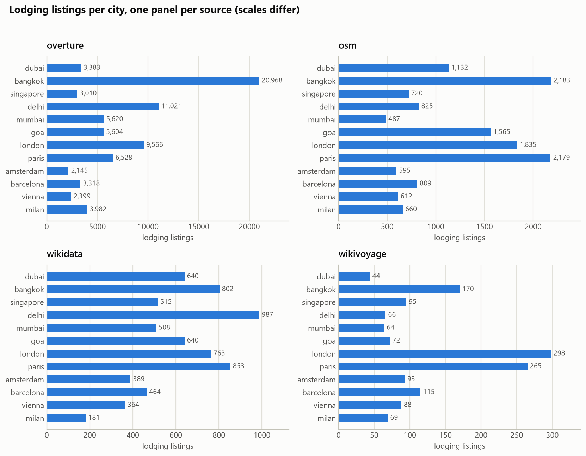
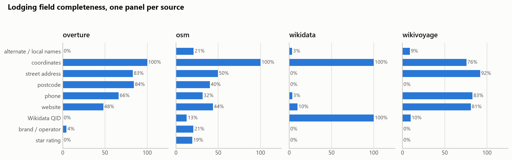
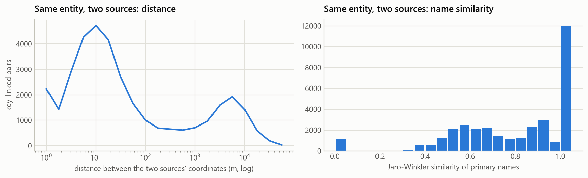

# EDA — four open sources as suppliers: Overture, OpenStreetMap, Wikidata, Wikivoyage (12 cities)

Each source was built independently, so each behaves like a supplier with its own naming, geocoding and completeness habits. Overture Places (CDLA-Permissive-2.0, release 2026-10-21) blends Meta, Microsoft, Foursquare and smaller feeds; OpenStreetMap (ODbL) is crowd-mapped; Wikidata (CC0) is an encyclopaedic graph; Wikivoyage (CC BY-SA) is traveller-written prose listings. All four are commercially usable. The table `data/interim/listings.parquet` holds them in one canonical schema.

## 1. Volume per city and source

**Lodging listings**

| City | overture | osm | wikidata | wikivoyage | Total |
|---|---:|---:|---:|---:|---:|
| dubai | 3,383 | 1,132 | 640 | 44 | 5,199 |
| bangkok | 20,968 | 2,183 | 802 | 170 | 24,123 |
| singapore | 3,010 | 720 | 515 | 95 | 4,340 |
| delhi | 11,021 | 825 | 987 | 66 | 12,899 |
| mumbai | 5,620 | 487 | 508 | 64 | 6,679 |
| goa | 5,604 | 1,565 | 640 | 72 | 7,881 |
| london | 9,566 | 1,835 | 763 | 298 | 12,462 |
| paris | 6,528 | 2,179 | 853 | 265 | 9,825 |
| amsterdam | 2,145 | 595 | 389 | 93 | 3,222 |
| barcelona | 3,318 | 809 | 464 | 115 | 4,706 |
| vienna | 2,399 | 612 | 364 | 88 | 3,463 |
| milan | 3,982 | 660 | 181 | 69 | 4,892 |

**Attraction listings**

| City | overture | osm | wikidata | wikivoyage | Total |
|---|---:|---:|---:|---:|---:|
| dubai | 5,248 | 1,341 | 417 | 77 | 7,083 |
| bangkok | 31,953 | 3,224 | 1,363 | 219 | 36,759 |
| singapore | 11,575 | 3,014 | 828 | 157 | 15,574 |
| delhi | 16,702 | 2,838 | 323 | 213 | 20,076 |
| mumbai | 15,218 | 2,091 | 220 | 197 | 17,726 |
| goa | 2,344 | 1,396 | 137 | 38 | 3,915 |
| london | 33,000 | 11,241 | 8,492 | 741 | 53,474 |
| paris | 13,471 | 5,885 | 7,801 | 260 | 27,417 |
| amsterdam | 5,123 | 1,500 | 3,106 | 141 | 9,870 |
| barcelona | 7,369 | 2,869 | 2,815 | 128 | 13,181 |
| vienna | 6,247 | 4,842 | 2,294 | 243 | 13,626 |
| milan | 5,981 | 1,993 | 1,396 | 94 | 9,464 |

*The sources differ by two orders of magnitude in coverage: Overture lists thousands of lodgings per city, Wikidata and Wikivoyage dozens.*

Total: **99,691 lodging** and **228,165 attraction** listings across the four sources.

## 2. Overture is already a blend of providers

| Provider behind the Overture record | Lodging | Share of lodging | Attractions |
|---|---:|---:|---:|
| meta | 54,469 | 70.2% | 131,878 |
| BrightQuery | 13,869 | 17.9% | 14,891 |
| Microsoft | 6,780 | 8.7% | 2,731 |
| Foursquare | 1,284 | 1.7% | 3,946 |
| AllThePlaces | 1,079 | 1.4% | 724 |
| OpenTravel | 40 | 0.1% | 0 |
| Uberall | 20 | 0.0% | 39 |
| DAC | 3 | 0.0% | 0 |
| PinMeTo | 0 | 0.0% | 22 |

Overture conflates its providers before release, so it counts as one supplier here, with the provider kept as an attribute. Its Foursquare share also makes the separate (now gated) Foursquare OS Places download optional.

Overture's own existence confidence: p10 0.40, median 0.73; 15.6% of its travel listings score below 0.5 (possibly closed or spurious). That score is a ready-made supplier-quality feature.

## 3. Field completeness by source (lodging)

| Field | overture | osm | wikidata | wikivoyage |
|---|---:|---:|---:|---:|
| alternate / local names | 0.0% | 21.0% | 3.4% | 8.8% |
| coordinates | 100.0% | 100.0% | 100.0% | 75.7% |
| street address | 82.9% | 49.5% | 0.0% | 91.9% |
| postcode | 84.3% | 40.0% | 0.0% | 0.0% |
| phone | 66.2% | 31.5% | 3.5% | 82.9% |
| website | 48.0% | 43.8% | 9.7% | 80.8% |
| Wikidata QID | 0.0% | 12.7% | 100.0% | 9.7% |
| brand / operator | 4.4% | 20.6% | 0.0% | 0.0% |
| star rating | 0.0% | 19.2% | 0.0% | 0.0% |

*No source is complete: Overture has phones and websites but no IDs or stars; OSM has addresses and some QIDs; Wikidata has QIDs and little else.*

## 4. Coordinate quality by source

| Source | With coordinates | Outside the city bbox | <= 3 decimals (~100 m) | 4 decimals (~10 m) | >= 5 decimals (~1 m) | On a point shared with another listing | Most listings on one point |
|---|---:|---:|---:|---:|---:|---:|---:|
| overture | 231,775 | 0.0% | 0.3% | 1.6% | 98.1% | 6.1% | 306 |
| osm | 55,836 | 0.0% | 0.0% | 0.0% | 100.0% | 0.1% | 3 |
| wikidata | 36,244 | 0.0% | 2.9% | 17.0% | 80.1% | 2.3% | 35 |
| wikivoyage | 3,210 | 0.3% | 5.2% | 25.5% | 69.3% | 3.0% | 3 |

Decimal places and shared points are the two cheap signals the supplier profiler needs: they say how far a source's distance evidence can be trusted.

## 5. Scripts and languages in names

| City | Non-ASCII primary name | Arabic | Thai | Han | Devanagari | Has an alternate-language name |
|---|---:|---:|---:|---:|---:|---:|
| dubai | 8.6% | 6.8% | 0.0% | 0.1% | 0.0% | 15.3% |
| bangkok | 65.7% | 0.1% | 65.1% | 0.3% | 0.0% | 7.8% |
| singapore | 4.9% | 0.0% | 0.1% | 4.1% | 0.0% | 9.3% |
| delhi | 2.3% | 0.1% | 0.0% | 0.0% | 1.9% | 2.7% |
| mumbai | 1.6% | 0.0% | 0.0% | 0.0% | 1.4% | 2.4% |
| goa | 0.9% | 0.0% | 0.0% | 0.0% | 0.2% | 3.3% |
| london | 1.3% | 0.1% | 0.0% | 0.1% | 0.0% | 1.7% |
| paris | 32.1% | 0.1% | 0.0% | 0.3% | 0.0% | 14.1% |
| amsterdam | 2.3% | 0.1% | 0.0% | 0.1% | 0.0% | 10.4% |
| barcelona | 26.2% | 0.1% | 0.0% | 0.1% | 0.0% | 13.7% |
| vienna | 15.8% | 0.1% | 0.0% | 0.2% | 0.0% | 13.1% |
| milan | 3.4% | 0.1% | 0.0% | 0.2% | 0.0% | 8.1% |

Bangkok is the stress test: a large share of primary names are in Thai script in one source and romanised in another, so character similarity is zero for a true match unless alternate names or transliteration are used.

## 6. Keys that link the same entity across sources (weak labels)

| Source | Listings (in bbox) | With Wikidata QID | With phone | With website |
|---|---:|---:|---:|---:|
| overture | 231,774 | 0 | 133,210 | 102,491 |
| osm | 55,836 | 12,962 | 7,130 | 14,186 |
| wikidata | 36,244 | 36,244 | 594 | 5,094 |
| wikivoyage | 3,201 | 1,650 | 1,851 | 2,224 |

Joining listings of *different* sources in the same city on an identical QID, phone (last 8 digits) or URL gives **34,482 key-linked pairs**. URLs count only when they carry a path or the domain is rare in the city, so a chain's home page does not link all its hotels.

| Linking key(s) | Pairs |
|---|---:|
| phone | 11,388 |
| qid | 10,352 |
| url | 7,718 |
| phone+url | 3,086 |
| qid+url | 1,483 |
| phone+qid+url | 228 |
| phone+qid | 227 |

| Source pair | Pairs | via QID | via phone | via URL |
|---|---:|---:|---:|---:|
| osm x overture | 15,049 | 0 | 10,652 | 6,702 |
| osm x wikidata | 10,323 | 9,927 | 321 | 1,460 |
| overture x wikivoyage | 3,130 | 0 | 2,535 | 1,048 |
| overture x wikidata | 2,939 | 0 | 734 | 2,348 |
| osm x wikivoyage | 1,712 | 1,144 | 565 | 536 |
| wikidata x wikivoyage | 1,329 | 1,219 | 122 | 421 |

| City | Key-linked pairs | of which lodging-lodging |
|---|---:|---:|
| dubai | 1,028 | 678 |
| bangkok | 2,251 | 915 |
| singapore | 1,959 | 571 |
| delhi | 1,095 | 645 |
| mumbai | 534 | 228 |
| goa | 3,723 | 3,587 |
| london | 9,010 | 1,959 |
| paris | 5,669 | 1,974 |
| amsterdam | 1,796 | 651 |
| barcelona | 1,854 | 750 |
| vienna | 3,622 | 560 |
| milan | 1,941 | 728 |

### Not every shared key is evidence: hub phones

**451 phone numbers are each attached to more than five listings** in one city, 11,883 listings in total. The largest hub, in delhi, is one number on 1,589 listings: a chain's reservation call centre, not a hotel's front desk. A key that many listings share carries almost no evidence, so key strength has to be weighted by how rare the value is.

| Linking key(s) | Pairs | Within 100 m | Within 500 m | Over 2 km | Name JW >= 0.85 (incl. alternate names) |
|---|---:|---:|---:|---:|---:|
| phone | 11,388 | 40.5% | 47.5% | 43.4% | 30.7% |
| qid | 10,352 | 92.4% | 98.9% | 0.3% | 82.5% |
| url | 7,718 | 67.8% | 74.7% | 19.3% | 59.4% |
| phone+url | 3,086 | 91.4% | 94.9% | 2.8% | 77.5% |
| qid+url | 1,483 | 94.5% | 99.2% | 0.1% | 86.4% |
| phone+qid+url | 228 | 97.4% | 99.6% | 0.4% | 93.0% |
| phone+qid | 227 | 96.0% | 99.6% | 0.4% | 91.6% |

A shared QID is clean (almost every pair within 500 m). A shared phone alone is not: under half of those pairs are within 500 m. Two independent keys agreeing is nearly as clean as a QID.

### How hard are these real cross-source duplicates?

| Median distance | p90 | p99 | > 300 m | > 2 km | Median name JW | Name JW < 0.8 | JW < 0.8 even with alternate names | Names identical | QIDs conflict |
|---:|---:|---:|---:|---:|---:|---:|---:|---:|---:|
| 22 m | 6926 m | 26,393 m | 25.4% | 19.0% | 0.870 | 43.8% | 36.2% | 29.6% | 0.6% |

A shared phone or URL is not proof (19.0% of key-linked pairs are more than 2 km apart, and 0.6% carry two different QIDs: call centres, chains, a museum and the park around it). Weak labels therefore use the key **plus** a sanity condition, and the QID conflicts become trusted negatives.

*Real cross-source duplicates: most sit within tens of metres, but a tail runs to kilometres, and a visible share have dissimilar primary names.*

Key-linked pairs within 300 m whose primary names disagree (the cases that defeat string matching):

| City | Sources | Name A | Name B | Dist (m) | JW | Key |
|---|---|---|---|---:|---:|---|
| london | overture / wikivoyage | The Jewish Museum London | Jewish Museum | 21 | 0.72 | url |
| bangkok | osm / overture | ริเวอร์ซิตี | Pokémon Trading Card Game Arts and Learning Gallery | 14 | 0 | phone |
| vienna | osm / overture | Pfarrkirche Marienpfarre | Marienkirche Hernals | 233 | 0.66 | phone |
| barcelona | osm / overture | Parc d'Atraccions Tibidabo | Muntanya Russa | 4 | 0.5 | phone |
| london | osm / overture | Kingsway International Christian Centre | KICCFrenchConnection | 23 | 0.57 | url |
| paris | osm / wikidata | Basilique Sainte-Clotilde | Sainte-Clotilde Church | 4 | 0.66 | qid+url |
| bangkok | osm / overture | Le Méridien Bangkok | โรงแรม เลอ เมอริเดียน กรุงเทพฯ | 24 | 0.38 | phone |
| london | overture / wikivoyage | The Rosetta Stone | British Museum | 85 | 0.49 | phone+url |
| paris | osm / wikidata | Église Sainte-Rosalie | Sainte-Rosalie | 8 | 0.75 | qid |
| paris | osm / overture | Théâtre Libre | Le Théâtre Libre / La Scène Libre | 17 | 0.65 | phone+url |
| london | osm / overture | United Reformed Church | Hampton Hill United Reformed Church | 14 | 0.72 | url |
| paris | osm / overture | Hôtel Renaissance Paris La Defense | Renaissance Hotels | 45 | 0.69 | phone |
| bangkok | osm / wikidata | วัดเขียน | Wat Khian | 39 | 0 | qid |
| london | osm / overture | Shiva Temple | Eelapatheeswarar Aalayam | 9 | 0.56 | phone |

## 7. How much do the sources overlap? (lodging, OSM against Overture)

| City | OSM lodgings | With any Overture lodging within 300 m | With a name match (JW >= 0.9) within 300 m | Mean Overture candidates within 300 m |
|---|---:|---:|---:|---:|
| dubai | 1,132 | 93.0% | 43.6% | 13.8 |
| bangkok | 2,183 | 99.2% | 40.8% | 38.8 |
| singapore | 720 | 96.0% | 56.5% | 20.3 |
| delhi | 825 | 96.0% | 30.1% | 49.6 |
| mumbai | 487 | 97.9% | 35.7% | 15.3 |
| goa | 1,565 | 93.7% | 27.2% | 24.6 |
| london | 1,835 | 99.0% | 60.7% | 38.8 |
| paris | 2,179 | 99.6% | 51.4% | 33.8 |
| amsterdam | 595 | 97.8% | 53.8% | 35.2 |
| barcelona | 809 | 99.6% | 54.9% | 51.7 |
| vienna | 612 | 96.9% | 47.5% | 17.2 |
| milan | 660 | 99.5% | 62.3% | 26.3 |

Across cities, **46.6%** of OSM lodgings have an obvious Overture twin (same place, near-identical name). The rest are either missing from Overture, named differently, or geocoded further away: that remainder is what the matcher is for. The candidate counts also show why 300 m blocking alone is not enough in dense districts.

## 8. Duplicates left inside a conflated source

Inside Overture alone, **681 pairs** share a phone, sit within 200 m and have near-identical names: duplicates that survived Overture's own conflation.

| Provider pair | Likely duplicate pairs |
|---|---:|
| meta x meta | 468 |
| Microsoft x Microsoft | 57 |
| Foursquare x meta | 40 |
| meta x Foursquare | 37 |
| BrightQuery x meta | 23 |
| meta x BrightQuery | 23 |
| Microsoft x meta | 19 |
| meta x Microsoft | 14 |

Even a professionally conflated feed carries residual duplicates, which supports auditing an existing mapping instead of trusting it blindly.

## 9. Category vocabularies do not line up

| overture: top attraction categories | Listings |
|---|---:|
| cultural_and_historic/historic_site | 41,552 |
| sports_and_recreation/park | 12,086 |
| arts_and_entertainment | 10,265 |
| cultural_and_historic/place_of_worship/christian_place_of_worship | 9,048 |
| arts_and_entertainment/arts_and_crafts_space/art_gallery | 8,010 |
| cultural_and_historic/place_of_worship/hindu_place_of_worship | 6,818 |
| cultural_and_historic/religious_organization | 6,385 |
| arts_and_entertainment/performing_arts_venue/music_venue | 5,687 |

| osm: top attraction categories | Listings |
|---|---:|
| amenity=place_of_worship | 9,446 |
| leisure=park | 7,783 |
| historic=memorial | 5,498 |
| tourism=attraction | 2,455 |
| leisure=garden | 1,975 |
| tourism=gallery | 1,307 |
| tourism=museum | 1,244 |
| amenity=marketplace | 1,178 |

| wikidata: top attraction categories | Listings |
|---|---:|
| church building | 2,481 |
| sculpture | 2,162 |
| square | 1,781 |
| bridge | 1,519 |
| sepulchral chapel | 1,093 |
| movie theater | 850 |
| wat | 825 |
| park | 788 |

Three taxonomies, three granularities, and noisy assignments (Overture labels many residential towers as historic sites). Category agreement can only be a soft feature after mapping to a small canonical type list.

## 10. What this means for the build

- **A real benchmark exists.** 34,482 cross-source pairs are linked by an independent key across 12 cities; after sanity filtering they are weak positives, and QID conflicts are trusted negatives. The pair model must be trained without the key features and judged against them.
- **Geography and names both fail alone.** 25.4% of key-linked pairs are over 300 m apart and 43.8% have primary-name similarity below 0.8 (36.2% even when alternate-language names are used).
- **Alternate names are worth carrying.** They recover a share of the cross-script matches for free; the rest needs transliteration or an embedding.
- **Profile the supplier first.** Completeness, decimal precision and shared-point rates differ sharply by source and should weight every feature.
- **Hold out by city.** Dubai, Bangkok and Singapore differ in script mix and density; train on some cities and report on an unseen one.
