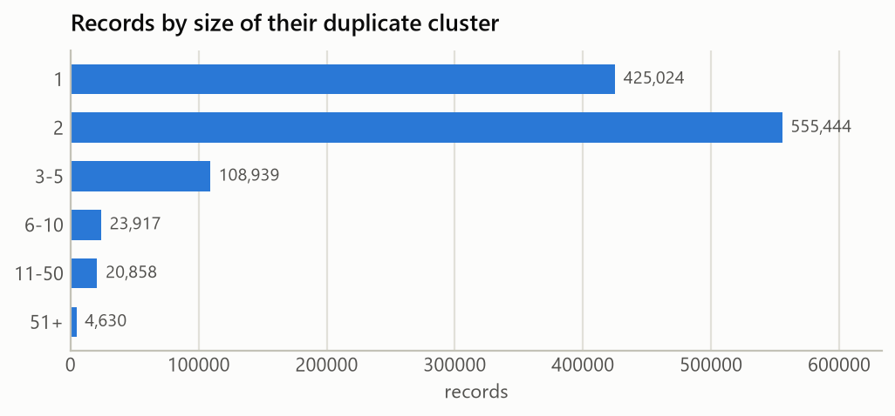
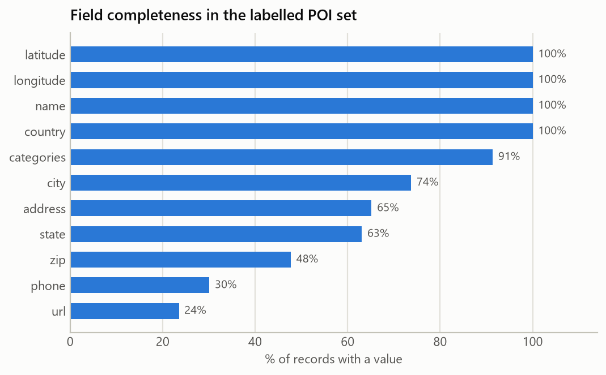
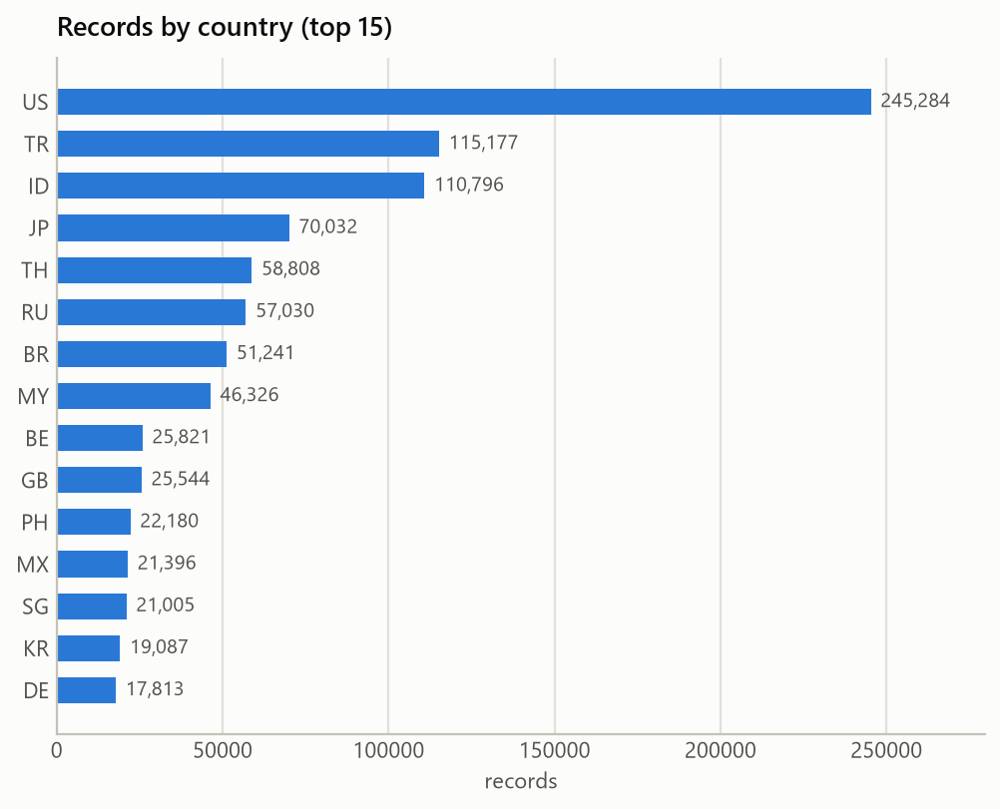
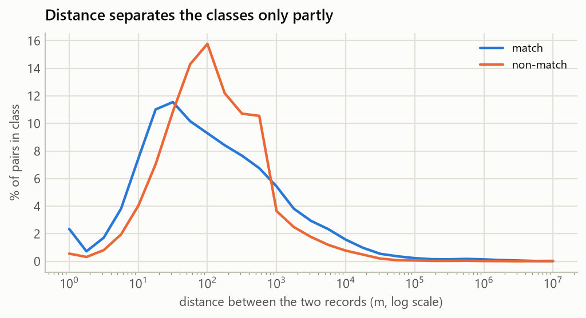
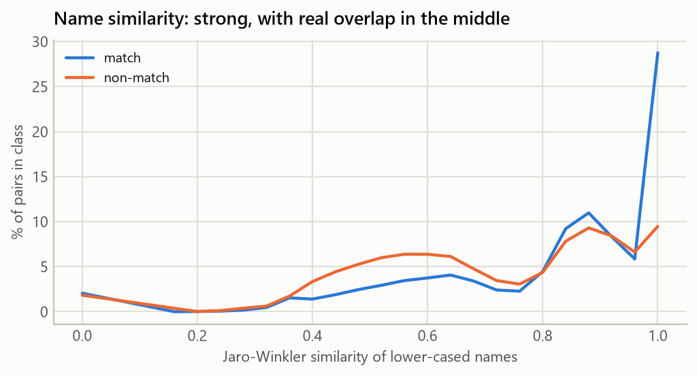

# EDA — Foursquare Location Matching (labelled POI duplicates)

Source: Kaggle competition `foursquare-location-matching` (2022). The competition page no longer serves the files; this is the community parquet mirror `robikscube/foursquare-location-matching-parquet`. **Competition terms apply: research / benchmarking only, not for a shipped model.**

## 1. Size and label structure

`train`: **1,138,812 records** describing **739,972 real places** (`point_of_interest`). 314,948 places (42.6%) have more than one record; those hold 713,788 records (62.7%) and imply **950,503 true duplicate pairs**. All possible pairs number 6.484e+11, so a true pair is 1 in 682,213: blocking decides everything before any classifier runs.

| Records per place | Places | Records | Share of records |
|---|---:|---:|---:|
| 1 | 425,024 | 425,024 | 37.3% |
| 2 | 277,722 | 555,444 | 48.8% |
| 3-5 | 32,656 | 108,939 | 9.6% |
| 6-10 | 3,315 | 23,917 | 2.1% |
| 11-50 | 1,202 | 20,858 | 1.8% |
| 51+ | 53 | 4,630 | 0.4% |

*Most records sit in clusters of two to five; singletons are the negatives the matcher must leave alone.*

## 2. Field completeness

| Field | Non-null share |
|---|---:|
| latitude | 100.0% |
| longitude | 100.0% |
| name | 100.0% |
| country | 100.0% |
| categories | 91.4% |
| city | 73.7% |
| address | 65.2% |
| state | 63.1% |
| zip | 47.7% |
| phone | 30.1% |
| url | 23.5% |

*Name and coordinates are always there; phone and URL are missing for most records.*

## 3. Geography, categories and scripts

221 countries. Top 15:

| Country | Records | Share |
|---|---:|---:|
| US | 245,284 | 21.5% |
| TR | 115,177 | 10.1% |
| ID | 110,796 | 9.7% |
| JP | 70,032 | 6.1% |
| TH | 58,808 | 5.2% |
| RU | 57,030 | 5.0% |
| BR | 51,241 | 4.5% |
| MY | 46,326 | 4.1% |
| BE | 25,821 | 2.3% |
| GB | 25,544 | 2.2% |
| PH | 22,180 | 1.9% |
| MX | 21,396 | 1.9% |
| SG | 21,005 | 1.8% |
| KR | 19,087 | 1.7% |
| DE | 17,813 | 1.6% |

*The set is global, with the US, Turkey, Indonesia and Japan leading; names come in many scripts.*

| Category (top 15) | Records |
|---|---:|
| Cafés | 32,296 |
| Residential Buildings (Apartments / Condos) | 29,268 |
| Banks | 25,448 |
| Offices | 25,310 |
| Coffee Shops | 25,128 |
| College Classrooms | 24,774 |
| Hotels | 21,736 |
| Buildings | 19,976 |
| Fast Food Restaurants | 19,828 |
| Convenience Stores | 19,186 |
| Restaurants | 16,501 |
| Salons / Barbershops | 14,593 |
| Bars | 14,370 |
| Gas Stations | 14,245 |
| Shopping Malls | 14,065 |

**28.3%** of names contain non-ASCII characters (accents or a non-Latin script).

Travel-relevant slice (category keyword match), which is the part closest to TBO's catalogue:

| Slice | Records | Places |
|---|---:|---:|
| attraction | 50,725 | 35,352 |
| lodging | 31,285 | 20,532 |

## 4. Geo-jitter between records of the same place

Distance from each record to the median coordinate of its place (multi-record places only):

| p50 | p75 | p90 | p95 | p99 | > 1 km | > 5 km |
|---:|---:|---:|---:|---:|---:|---:|
| 48 m | 274 m | 1380 m | 4127 m | 42,026 m | 12.0% | 4.4% |

A hard distance cut-off loses real matches: 12.0% of duplicate records sit more than 1 km from their place. Distance has to be a feature weighted by the source's coordinate quality, not a veto.

## 5. Labelled pairs file (`pairs.parquet`)

578,907 candidate pairs supplied by the organisers, **68.9% labelled as matches**. They were pre-selected to be plausible, so the non-matches are hard negatives.

|  | Pairs | Median dist | p90 dist | Median name JW | p10 name JW | Names equal | Both have phone | Phones equal (when both) | Both have URL | Domains equal (when both) | Categories equal |
|---|---:|---:|---:|---:|---:|---:|---:|---:|---:|---:|---:|
| match | 398,786 | 108 m | 3,052 m | 0.893 | 0.519 | 28.8% | 15.4% | 43.9% | 9.5% | 80.0% | 38.3% |
| non-match | 180,121 | 144 m | 1,117 m | 0.749 | 0.458 | 9.5% | 15.1% | 13.2% | 12.8% | 54.1% | 24.7% |

Precision of exact-key rules on this file (base rate of a match is 68.9%, and the negatives were chosen to be confusable):

| Rule | Pairs it fires on | Share that are true matches |
|---|---:|---:|
| same phone | 30,525 | 88.2% |
| same website domain | 42,833 | 70.9% |
| same phone and < 200 m apart | 21,360 | 90.2% |
| same phone, < 200 m, name JW >= 0.85 | 16,620 | 92.9% |

*Matches peak near 30 m but have a long tail; hard negatives are neighbours about 100 m away, so distance alone cannot decide.*

*Many true matches have dissimilar names (translations, abbreviations); many non-matches share a name (chains).*

## 6. What this means for the matcher

- **Blocking first.** Only 1 in 682,213 possible pairs is a match. Candidate generation must combine geography with name similarity, because neither alone has both recall and a small candidate set.
- **No distance veto.** 12.0% of duplicate records are over 1 km from their place and 4.4% over 5 km.
- **Names are not enough.** 32.4% of true matches have name similarity below 0.8, while 7.8% of non-matches have near-identical names within 200 m (chains, branches, units inside one building).
- **Exact keys are strong evidence, not proof.** A shared phone alone is a true match 88.2% of the time on these hard pairs (a shared domain 70.9%): branches share call centres and chains share websites. Adding distance and name agreement lifts it to 92.9%. So stage 0 rules must be conjunctions, and their precision measured, not assumed.
- **Use.** Train and benchmark the pair model here (grouped split by `point_of_interest`), then test transfer on the city benchmark. Because of the competition terms, a shippable model is retrained on the open city data.
