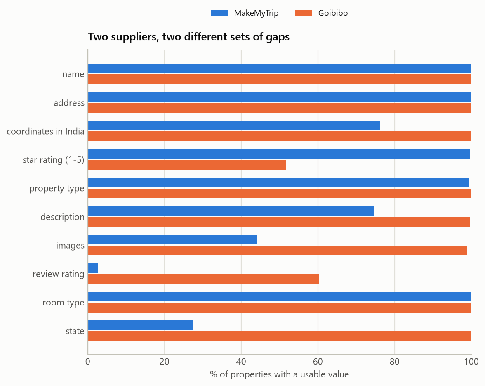
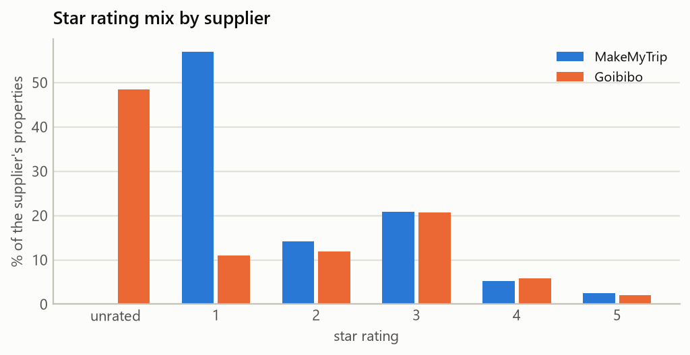
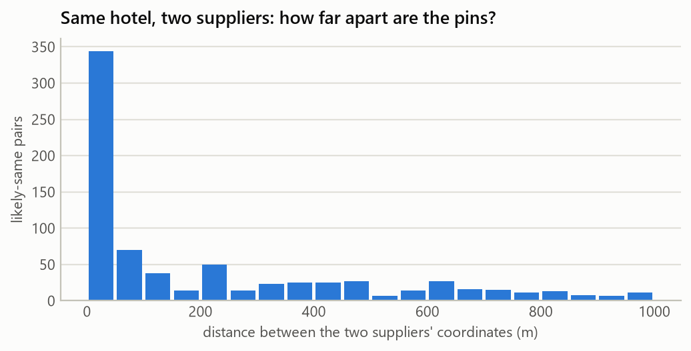
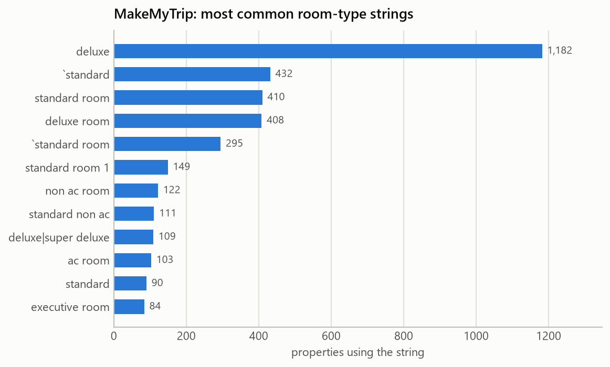
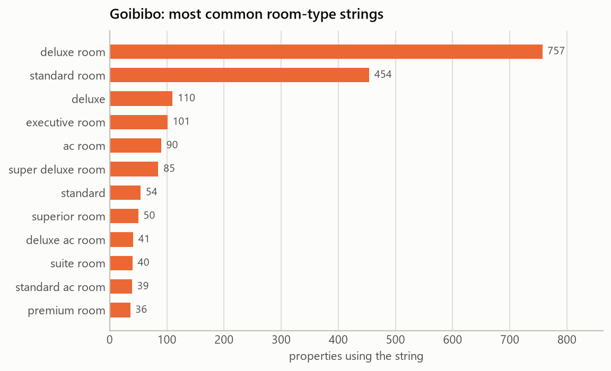

# EDA — MakeMyTrip and Goibibo hotel feeds (two real suppliers, India)

Source: Kaggle `PromptCloudHQ/hotels-on-makemytrip` and `PromptCloudHQ/hotels-on-goibibo` (CC BY-SA 4.0, crawled mid-2016). Both are samples, so the overlap measured here is a lower bound on what the two full catalogues share. Old data, but the feed defects are the ones the statement is about.

## 1. Size

| Supplier | Raw rows | Properties | Cities | States | Room-type strings |
|---|---:|---:|---:|---:|---:|
| makemytrip | 20,046 | 15,168 | 733 | 270 | 12,125 |
| goibibo | 4,000 | 4,000 | 555 | 39 | 4,000 |

City names are not normalised even inside one feed, for example: `NewDelhiAndNCR` = `New Delhi And NCR`; `Lonavala And Khandala` = `LonavalaAndKhandala`; `Mount Abu` = `MountAbu`; `Kovalam and Poovar` = `KovalamandPoovar`; `Port Blair` = `PortBlair`; `NubraValley` = `Nubra Valley`.

## 2. Field completeness per supplier (property level)

| Field | MakeMyTrip | Goibibo |
|---|---:|---:|
| name | 100.0% | 100.0% |
| address | 100.0% | 100.0% |
| coordinates in India | 76.2% | 99.9% |
| star rating (1-5) | 99.7% | 51.6% |
| property type | 99.4% | 100.0% |
| description | 74.7% | 99.6% |
| images | 44.0% | 98.9% |
| review rating | 2.7% | 60.4% |
| room type | 100.0% | 100.0% |
| state | 27.4% | 100.0% |

*Each feed is complete where the other is thin, which is why a golden record needs field-level survivorship.*

## 3. Coordinate quality

| Supplier | With coordinates | Outside India / zero | <= 3 decimals (>= ~100 m grid) | Share on a coordinate shared with another property | Most properties on one point |
|---|---:|---:|---:|---:|---:|
| makemytrip | 15,154 | 23.8% | 1.8% | 27.0% | 14 |
| goibibo | 4,000 | 0.1% | 0.4% | 20.9% | 42 |

A coordinate shared by many unrelated hotels is a locality centroid, not a location. The supplier profiler has to detect these so the matcher stops trusting distance for them.

## 4. Star ratings and property types

*The two feeds disagree on how much of the catalogue is unrated, so a star difference is weak evidence against a match.*

| Stars | MakeMyTrip | Goibibo |
|---|---:|---:|
| unrated | 0.3% | 48.4% |
| 1 | 56.9% | 11.1% |
| 2 | 14.1% | 12.0% |
| 3 | 20.9% | 20.7% |
| 4 | 5.3% | 5.8% |
| 5 | 2.5% | 2.0% |

| Supplier | Property type (top 6) | Properties |
|---|---:|---:|
| makemytrip | Hotel | 14,789 |
| makemytrip | Lodge | 149 |
| makemytrip | (null) | 98 |
| makemytrip | Guest House | 26 |
| makemytrip | Homestay | 23 |
| makemytrip | Houseboat | 21 |
| goibibo | Hotel | 2,314 |
| goibibo | Resort | 516 |
| goibibo | Guest House | 243 |
| goibibo | Homestay | 231 |
| goibibo | Service Apartment | 183 |
| goibibo | Lodge | 117 |

## 5. How many hotels do the two feeds share?

403 city names appear in both feeds after normalisation. Candidate pairs: one MakeMyTrip and one Goibibo property within about 1 km of each other (grid join on valid coordinates), scored by Jaro-Winkler on normalised names.

| Candidate tier (within 1 km) | Pairs |
|---|---:|
| all candidate pairs | 48,018 |
| normalised names identical | 469 |
| name JW >= 0.92, not identical (likely same hotel, different spelling) | 290 |
| name JW 0.85-0.92 (ambiguous band, needs more evidence) | 2,796 |

At JW >= 0.92, **584 of 4,000 Goibibo properties (14.6%)** have a likely MakeMyTrip twin (695 MakeMyTrip properties involved). These are unverified likely matches, to be confirmed by the matcher and a labelled sample.

For those likely-same pairs the two suppliers' coordinates differ by a median of **74 m** (p75 375 m, p90 662 m; 30.2% over 300 m), and the star rating differs in 53.8% of pairs (18.6% by two or more stars where both are rated).

*Even for the same hotel the two feeds rarely agree on the pin; a tail runs out to the 1 km search radius.*

A sample of pairs with JW >= 0.86 whose names are not identical (best Goibibo candidate per MakeMyTrip hotel, not hand-verified). Character similarity is inflated by generic tokens such as *Hotel*, *Residency* or a deity or locality name shared by a whole street, so this band mixes real spelling variants with different hotels. The pair model needs token-weighted name features (rare tokens count, generic ones do not), not raw string similarity:

| MakeMyTrip name | Goibibo name | Dist (m) | JW | MMT stars | Goibibo stars |
|---|---|---:|---:|---:|---:|
| HOTEL REVA REGENCY | Hotel Rajhans Regent | 901 | 0.881 | 1 | 3 |
| Hotel Kala Sai | Hotel Pratham Sai | 597 | 0.913 | 2 | 0 |
| Casa Melhor 2BHK Luxurious Apartment Siolim | Casa Melhor  2BHK in SIolim | 449 | 0.898 | 1 | 1 |
| Hotel Anand Heritage | Hotel Sai Sangeeta | 309 | 0.888 | 3 | 3 |
| Hotel Dream | Hotel Paradise | 942 | 0.905 | 2 | 3 |
| Sri venkateshwara hotel | SRI  VENKATESWARA HOTEL | 906 | 0.964 | 1 | 1 |
| Hotel Supreme | Hotel President | 762 | 0.88 | 2 | 3 |
| Hotel Darbar View | Hotel Rajdarbar | 326 | 0.868 | 1 | 2 |
| Corbett Fun Resort | Corbett Machaan Resort | 657 | 0.923 | 3 | 3 |
| Villa Calangute Phase 3 | Villa Calangute Phase 8 | 242 | 0.983 | 4 | 0 |
| Hotel Heaven Canal | Hotel Pandit Palace | 886 | 0.86 | 1 | 3 |
| Hotel Astoria | Hotel Rosh | 561 | 0.896 | 1 | 1 |
| The Stay Inn | The Stay Inn Bed &amp; Breakfast | 68 | 0.88 | 3 | 0 |
| Hotel  Anjalik | Hotel Sarthak | 97 | 0.877 | 1 | 3 |

The opposite failure also exists: **73** pairs share an identical normalised name and city but sit more than 2 km apart (a wrong geocode at one supplier, or two branches of one brand). Geo-blocking alone would never propose these pairs; a name-based blocking key is needed alongside the geographic one.

## 6. Duplicates inside one supplier

| Supplier | Name + city + ~100 m cell used by more than one property ID | Property IDs involved |
|---|---:|---:|
| makemytrip | 1,694 | 3,388 |
| goibibo | 2 | 4 |

Supplier-internal duplicates exist before any cross-supplier matching. The clustering step should flag clusters that hold two records from one supplier.

## 7. Room-type strings

| Supplier | Room strings (property x room) | Distinct raw | Distinct after lower/trim | Distinct after removing punctuation and spaces |
|---|---:|---:|---:|---:|
| makemytrip | 12,125 | 4,917 | 4,897 | 4,516 |
| goibibo | 4,000 | 1,297 | 1,078 | 949 |

*MakeMyTrip: a handful of generic names cover most properties; the long tail is where extraction is needed.*

*Goibibo: a handful of generic names cover most properties; the long tail is where extraction is needed.*

Room strings are analysed with the Booking.com room names in `rooms.md`.
