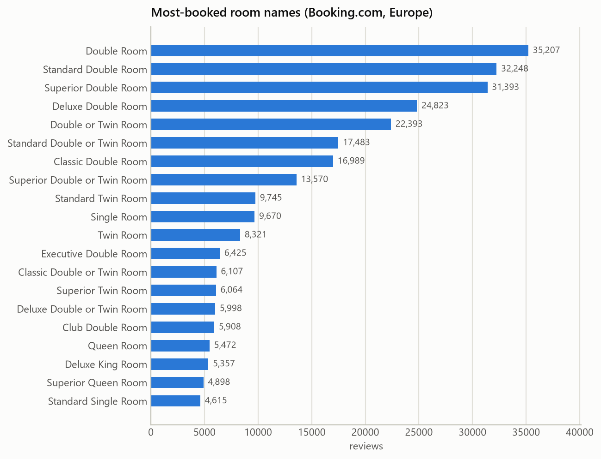
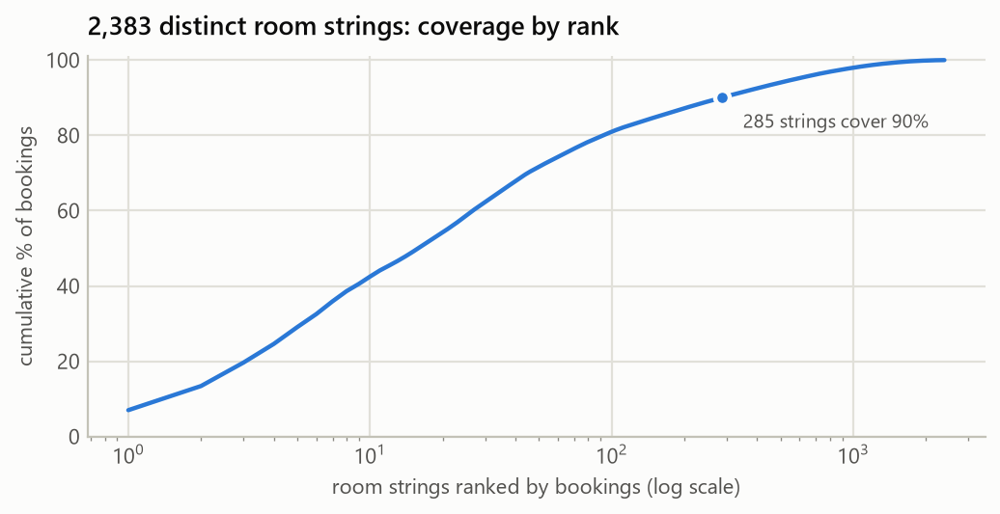
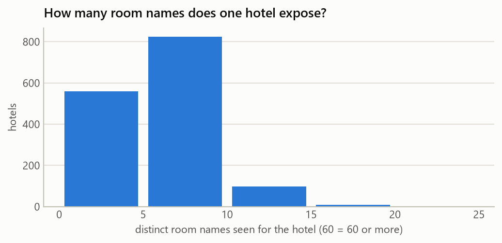
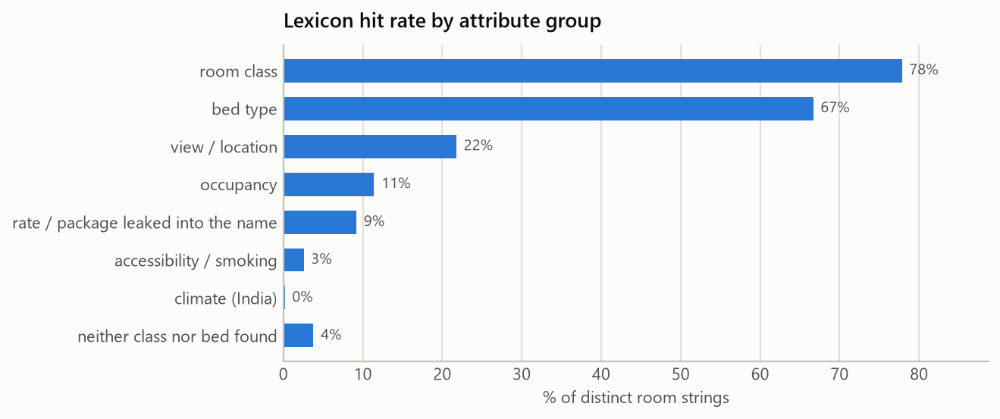

# EDA — real room-name strings (Booking.com Europe, MakeMyTrip and Goibibo India)

Sources: Kaggle `jiashenliu/515k-hotel-reviews-data-in-europe` (CC0; Booking.com reviews of luxury hotels in London, Paris, Amsterdam, Barcelona, Vienna and Milan, 2015-2017) and the two PromptCloud OTA samples. Each Booking review carries the name of the room that was booked, which gives real room names weighted by how often they sell.

## 1. Size

| Reviews | Hotels | Reviews with a room tag | Hotel x room combinations | Distinct room strings | Distinct after lower-casing |
|---:|---:|---:|---:|---:|---:|
| 515,738 | 1,492 | 502,636 (97.5%) | 8,393 | 2,383 | 2,376 |

## 2. A few names cover most bookings, and the tail is long

| Room string (top 20) | Reviews | Hotels using it |
|---|---:|---:|
| Double Room | 35,207 | 211 |
| Standard Double Room | 32,248 | 200 |
| Superior Double Room | 31,393 | 342 |
| Deluxe Double Room | 24,823 | 267 |
| Double or Twin Room | 22,393 | 139 |
| Standard Double or Twin Room | 17,483 | 78 |
| Classic Double Room | 16,989 | 160 |
| Superior Double or Twin Room | 13,570 | 164 |
| Standard Twin Room | 9,745 | 90 |
| Single Room | 9,670 | 260 |
| Twin Room | 8,321 | 126 |
| Executive Double Room | 6,425 | 135 |
| Classic Double or Twin Room | 6,107 | 48 |
| Superior Twin Room | 6,064 | 100 |
| Deluxe Double or Twin Room | 5,998 | 93 |
| Club Double Room | 5,908 | 48 |
| Queen Room | 5,472 | 25 |
| Deluxe King Room | 5,357 | 85 |
| Superior Queen Room | 4,898 | 35 |
| Standard Single Room | 4,615 | 76 |

*Generic names dominate: the same string means a different physical room in every hotel.*

| Top-k strings | Share of bookings covered |
|---|---:|
| top 10 | 42.5% |
| top 50 | 71.7% |
| top 100 | 81.0% |
| top 250 | 89.0% |
| top 500 | 94.1% |
| top 1000 | 98.0% |

*285 strings cover 90% of bookings; the remaining 2,098 strings are the long tail a lexicon will miss.*

1,884 of 2,383 strings (79.1%) are used by a single hotel; only 98 are used by ten or more hotels, yet those 98 strings account for 74.0% of bookings. Caching extraction per unique string therefore pays off immediately, and model calls scale with the tail, not with the catalogue.

## 3. Room names per hotel

| min | p25 | median | p75 | p90 | max |
|---:|---:|---:|---:|---:|---:|
| 1 | 4 | 5 | 7 | 9 | 20 |

*A typical hotel shows a dozen or more room names on a single channel, before any second supplier is added.*

## 4. What a plain lexicon can and cannot extract

Share of Booking.com room strings in which each attribute group is detected by regular expressions:

| Attribute group | Share of distinct strings | Share of bookings |
|---|---:|---:|
| room class | 77.8% | 71.8% |
| bed type | 66.7% | 89.4% |
| view / location | 21.8% | 4.7% |
| occupancy | 11.4% | 2.7% |
| rate / package leaked into the name | 9.2% | 1.4% |
| accessibility / smoking | 2.6% | 1.1% |
| climate (India) | 0.2% | 0.0% |
| neither class nor bed found | 3.8% | 0.6% |

*Class and bed type are usually stated; rate and package terms leak into a visible share of room names.*

Strings where the lexicon finds neither a class nor a bed type (most booked first), the work left for the model stage:

| Room string | Reviews |
|---|---:|
| Room Selected at Check In | 418 |
| Camper Room | 225 |
| Wonderful Room | 198 |
| City Room | 144 |
| Room with Ramblas View | 144 |
| Two Connecting Rooms | 143 |
| Special Room | 112 |
| Mini Room | 107 |
| Art Room with Iconic View | 101 |
| X Ordinary Room | 89 |
| One Bed Feature Room | 82 |
| Quintuple Room | 72 |
| Two Adjacent Rooms 6 persons | 59 |
| Romantic Special Offer | 50 |
| Special Offer Princess Relax | 42 |

**Room and rate are tangled in the name**: 219 strings (9.2%) carry a board, refund or package term. Examples:

| Room string with a rate or package term | Reviews |
|---|---:|
| Executive King Room with Lounge Access | 585 |
| Double or Twin Room with Spa Access | 379 |
| Standard Room with Spa access | 310 |
| Special Offer Double Room | 288 |
| Classic Double or Twin Room with Spa Access | 269 |
| Special Offer Queen Room | 212 |
| Superior Double Room with Spa Access | 199 |
| Superior Room with Spa access | 185 |
| Executive Queen Room with Lounge Access | 185 |
| Junior Suite with Spa Access | 145 |
| Special Offer Superior Double Room | 134 |
| Special Room | 112 |

## 5. Confusable names inside one hotel

Within one hotel, **910 pairs of room names differ by exactly one token** (for example *Double Room* vs *Superior Double Room*), across 532 of 1,492 hotels. Another 8 pairs in 7 hotels have the same tokens in a different order or with different punctuation. The first kind must stay separate (the token is the difference); the second kind should merge. String similarity cannot tell the two apart, attribute extraction can.

| Hotel | Room name A | Room name B |
|---|---|---|
| Hotel Murmuri Barcelona | One Bedroom Apartment | One Bedroom Apartment Penthouse |
| Park Plaza County Hall London | Studio Double Family | Studio Double Room |
| Andaz Amsterdam Prinsengracht A Hyatt Hotel | Garden View King | Large Garden View King |
| Park International Hotel | Deluxe Double Room | Double Room |
| Durrants Hotel | Double or Twin Room | Large Double or Twin Room |
| Durrants Hotel | Double or Twin Room | Superior Double or Twin Room |
| Durrants Hotel | Double or Twin Room | Twin Room |
| Hotel VIU Milan | Deluxe Double Room | Deluxe Double Room with Balcony |

## 6. Indian OTA room strings: does the same lexicon transfer?

| Supplier | Distinct strings | Class found | Bed type found | AC / non-AC stated | Rate term leaked | Neither class nor bed |
|---|---:|---:|---:|---:|---:|---:|
| MakeMyTrip | 4,897 | 87.2% | 28.6% | 36.3% | 1.5% | 7.6% |
| Goibibo | 1,078 | 61.7% | 22.5% | 32.0% | 2.6% | 27.2% |

Most common Indian strings the lexicon cannot place: `non ac room` (146), `ac room` (126), `ac room` (90), `guest room` (53), `non ac room|ac room` (40), `non ac room` (35), `master room 1` (32), `tent` (30), `camp` (28), `2 bed non ac room` (25), `regular non ac room` (25), `ac rooms` (24), `houseboat` (23), `1 bhk` (23).

Bed type is rarely stated in the Indian feeds while air-conditioning is a first-class attribute, so the canonical room schema needs a market-specific attribute set and the extractor must not treat a missing bed type as a mismatch.

## 7. What this means for room and rate mapping

- **Cache per unique string.** 285 strings cover 90% of bookings in this set; extraction cost follows the tail.
- **Lexicon first, model second.** Regular expressions already find a class or bed type in 96.2% of distinct strings (99.4% of bookings); the rest goes to the model stage.
- **Split room from rate before matching.** 9.2% of room names contain a board, refund or package term.
- **Match on attributes, not string similarity.** 910 same-hotel name pairs differ by a single token that is the whole difference.
- **Schema is market-specific.** AC / non-AC matters in India and is absent in Europe; bed type is the reverse.
