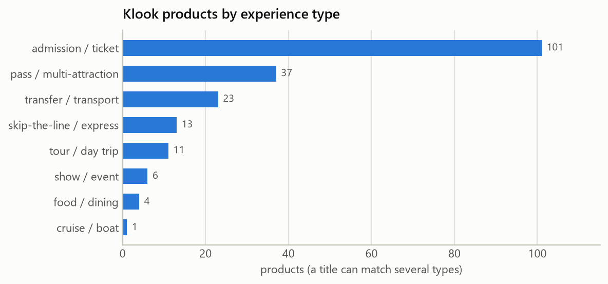
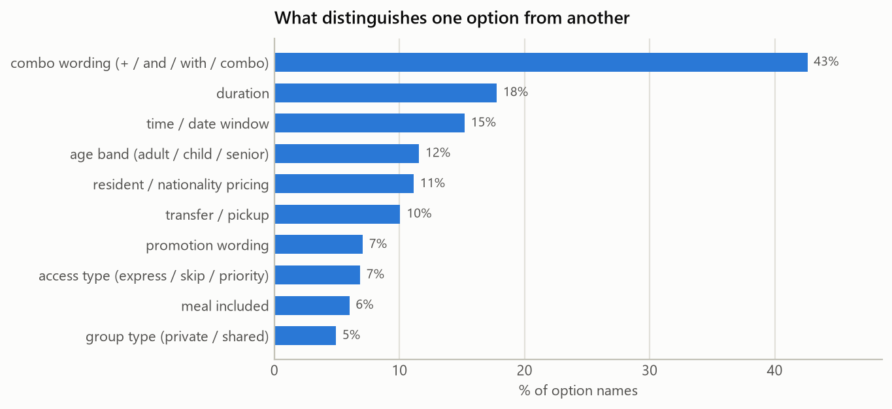
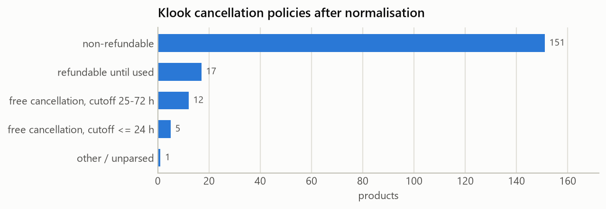

# EDA — sightseeing products and attractions (Klook, Viator sample, Wikivoyage, open POIs)

Public data for *products* (tickets, tours, options, inclusions) is scarce: the large marketplaces expose it only through partner APIs. What could be downloaded without an agreement is small, so this report is as much a gap analysis as an EDA. The Klook crawl has no stated licence and the Viator sample is marked 'other': both are for research and schema design only.

## 1. What we have

| Layer | Source | Rows | What it carries |
|---|---|---:|---|
| product + option | Klook crawl (SG, MY; 2019) | 192 products, 467 options | title, price, bookings, coordinates, cancellation policy text, package options |
| product | Viator tracker sample (8 cities; 2026) | 192 products | title, duration, price, rating, free-cancellation flag; no inclusions or options |
| attraction (POI) | Overture | 154,231 | name, category, coordinates, phone, website |
| attraction (POI) | OpenStreetMap | 42,234 | name (multilingual), coordinates, Wikidata QID on some |
| attraction (POI) | Wikidata | 29,192 | QID, labels, class, website |
| attraction (POI) | Wikivoyage see / do | 2,508 | name, prose description, price and hours text, coordinates, QID on some |

## 2. Klook products

| City | Products | With coordinates | With Google place ID | Median price (MYR) |
|---|---:|---:|---:|---:|
| Singapore | 87 | 87 | 15 | 76 |
| Kuala Lumpur | 42 | 40 | 13 | 103 |
| Penang | 16 | 15 | 4 | 52.5 |
| Johor Bahru | 13 | 13 | 5 | 126 |
| Melaka | 10 | 10 | 4 | 50 |
| Genting Highlands | 8 | 6 | 2 | 131.5 |
| Langkawi | 7 | 6 | 3 | 61 |
| Ipoh | 4 | 4 | 1 | 81 |
| Sarawak | 3 | 3 | 1 | 218 |
| Sabah | 2 | 2 | 1 | 313.5 |

Titles carry marketing tags in brackets (36 tags on 192 products; most common: `klook exclusive` (17), `klook exclusive: skip-the-line` (2), `direct entry` (2), `sale` (2), `up to 10% off` (2), `special promo` (2)), which must be stripped before matching and kept as attributes (for example *skip the line* is an access type, *sale* is not a product attribute at all).

| Experience type (keyword in title) | Products |
|---|---:|
| admission / ticket | 101 |
| pass / multi-attraction | 37 |
| transfer / transport | 23 |
| skip-the-line / express | 13 |
| tour / day trip | 11 |
| show / event | 6 |
| food / dining | 4 |
| cruise / boat | 1 |

*Entry tickets dominate; a sizeable share are passes or combos, the INCLUDES case of the product graph.*

## 3. Options: the level where products really differ

186 products expose 467 package options: median 2, max 9. 66% of products have more than one option.

| Options per product | Products |
|---|---:|
| 1 | 63 |
| 2 | 54 |
| 3 | 25 |
| 4 | 23 |
| 5 | 8 |
| 6+ | 13 |

| Attribute signalled in the option name | Share of options |
|---|---:|
| combo wording (+ / and / with / combo) | 42.6% |
| duration | 17.8% |
| time / date window | 15.2% |
| age band (adult / child / senior) | 11.6% |
| resident / nationality pricing | 11.1% |
| transfer / pickup | 10.1% |
| promotion wording | 7.1% |
| access type (express / skip / priority) | 6.9% |
| meal included | 6.0% |
| group type (private / shared) | 4.9% |

*Option names encode exactly the differences the statement lists: inclusions, access type, time windows, who the ticket is for.*

Examples of one product with several options (each option is a `VARIANT_OF` its siblings):

| Product | Options |
|---|---|
| Trick Eye Museum | [Limited offer - Buy 2 Get 1] Trick Eye Museum Admission ticket · Admission Ticket · [Klook Exclusive Offer] Admission Ticket + Luggage Tag |
| [Direct Entry] Singapore Night Safari With Tram Ride | 7:15pm Entry (last admission: 11:15pm) · 8:15pm Entry (last admission: 11:15pm) · 9:15pm Entry (last admission: 11:15pm) |
| [Klook Exclusive] Sanrio Hello Kitty Town & Thomas Town | [Free Gift] Hello Kitty + Thomas Town Combo (Group of 3 only) · [Klook Promo] Hello Kitty Town + MYR5 Cash Voucher · [Klook Promo] Thomas Town + MYR5 Cash Voucher · [Klook Promo] Hello Kitty Town and Thomas Town + MYR5 Cash Voucher · Hello Kitty Town |
| Singapore Cable Car Sky Pass | Sky Pass · Sky Pass + Meal · [Online Exclusive] Sky Pass Unlimited + Drink |

## 4. Cancellation policy text

186 products have a policy; their first lines come in **24 distinct wordings** (four spellings of the same 'no cancellations' sentence alone), which a small parser maps to 5 classes:

| Policy class | Products | Share |
|---|---:|---:|
| non-refundable | 151 | 81.2% |
| refundable until used | 17 | 9.1% |
| free cancellation, cutoff 25-72 h | 12 | 6.5% |
| free cancellation, cutoff <= 24 h | 5 | 2.7% |
| other / unparsed | 1 | 0.5% |

*Free text collapses into a handful of comparable classes with a cutoff in hours: the shape the canonical schema stores.*

## 5. Products cluster around attractions (families)

Grouping the 186 geocoded products by a ~100 m cell gives 142 locations; 34 of them host more than one product and those hold 78 products (42%). Inside one supplier these are siblings; across suppliers the same structure repeats, which is where `SAME_AS`, `VARIANT_OF` and `INCLUDES` are decided.

| City | Products at one location | Titles (first four) |
|---|---:|---|
| Singapore | 4 | S.E.A. Aquarium Ticket Sentosa, Singapore · Adventure Cove Waterpark · Trick Eye Museum · [20% OFF] S.E.A. Aquarium Ticket and Ya Kun Kaya Toast Combo Package in Singapore |
| Singapore | 3 | [Klook Exclusive] Universal Studios Singapore™ Ticket (1 Day Pass) · [Skip The Line] Universal Studios Singapore™ Express Pass · Universal Studios Singapore™ Admission Ticket and Express Pass Combo Package |
| Singapore | 3 | [Sale] Singapore Zoo Ticket and Ben & Jerry's Ice Cream Coupon Package · Night Safari Package Add Ons · Rainforest Lumina at Singapore Zoo |
| Singapore | 3 | iVenture Singapore Flexi Attractions / Plus Premium Pass · Singapore City Sightseeing Bus Tour · iVenture Singapore Unlimited Attractions Pass |
| Singapore | 3 | Singapore Flyer and Gardens by the Bay Package · Singapore Flyer Premium Beverage Flight · Singapore Flyer Flight  |
| Singapore | 3 | [Klook Exclusive] Universal Studios Singapore™ with Combo Packages in Sentosa · [Sale - 36% OFF] Singapore Cable Car Sky Pass and Co+Nut+Ink Signature Coconut Ice Cream in Husk Combo Package · [Klook Exclusive - Up to 30% OFF] S.E.A. Aquarium and Madame Tussauds Singapore/Trick Eye Museum Ticket Combo Package |
| Kuala Lumpur | 3 | Skytropolis Indoor Theme Park Ticket in Genting Highlands · Ripley's Adventureland, Jurassic Research Center, 4D Trick Art Museum & Zombie Outbreak Admission Tickets in Genting · Skytropolis Indoor Theme Park Ticket in Genting Highlands |
| Kuala Lumpur | 3 | Petrosains, The Discovery Centre Admission Ticket in Kuala Lumpur · Skip-The-Line PETRONAS Twin Towers Admission Ticket With Hotel Delivery · Petronas Twin Towers & Aquaria KLCC Admission Ticket |

Anchoring check: **83 of 87** geocoded Klook Singapore products have at least one open-data attraction listing within about 200 m, so linking products to canonical attractions by geography is feasible before any text is read.

## 6. Viator tracker sample

| Destination | Products | Median price (USD) | Median duration (min) | Free cancellation | Private tour |
|---|---:|---:|---:|---:|---:|
| Las Vegas | 24 | 107.72 | 180 | 92% | 0% |
| London | 24 | 96.28 | 240 | 96% | 8% |
| New York City | 23 | 69 | 180 | 87% | 13% |
| Dubai | 23 | 47 | 120 | 96% | 17% |
| Barcelona | 22 | 64.34 | 90 | 100% | 9% |
| Tokyo | 20 | 110.73 | 240 | 95% | 25% |
| Paris | 20 | 69.99 | 120 | 100% | 10% |
| Rome | 18 | 60.4 | 180 | 94% | 17% |
| Vatican City | 4 | 35.84 | 180 | 100% | 0% |
| Versailles | 3 | 503.47 | 240 | 100% | 67% |
| Asakusa | 2 | 134.81 | 105 | 100% | 0% |
| Pompeii | 2 | 120.08 |  | 100% | 0% |
| Bayeux | 1 | 903.08 |  | 100% | 100% |
| Ginza | 1 | 109 | 660 | 100% | 0% |
| Girona | 1 | 111.76 | 630 | 100% | 0% |
| Narita | 1 | 30 | 40 | 100% | 100% |
| Montserrat | 1 | 42.9 | 360 | 100% | 0% |
| Queens | 1 | 38.53 |  | 100% | 100% |
| Sharjah | 1 | 40 |  | 100% | 0% |

192 products in 19 cities, none of them a core TBO destination in this pull, and no inclusion or option fields. Useful only to confirm field names of Viator's listing summaries. **Viator's free Basic Access API is the real source and needs a sign-up.**

## 7. The gap, and how the build closes it

- **POI layer is solved with open data.** Tens of thousands of attraction listings across four sources, with QIDs as cross-source keys.
- **Product layer is thin.** 192 Klook products with 467 options and 192 Viator summaries; no city has the same attraction sold by two public sources at product depth.
- **Next data actions (need a person):** Viator Basic Access sign-up for Dubai, Bangkok and Singapore; ask the organisers for a TBO sightseeing sandbox.
- **Until then:** build the option-attribute extractor and the policy parser on the Klook strings, and generate supplier variants of real products (rename, add pickup, add meal, change cutoff, bundle two attractions) with known relation labels. Report those numbers as synthetic-supplier results, never as real cross-supplier accuracy.
