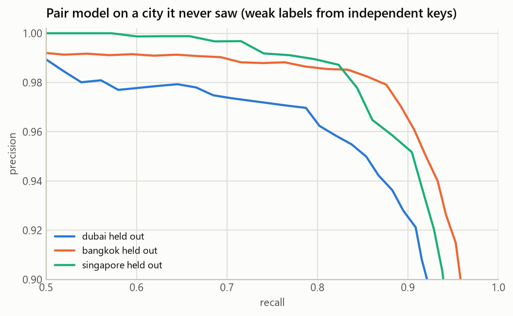

# Cross-source matcher on the 12-city open-data benchmark

Generated by `scripts/train/city_matcher.py`. Numbers come from **weak labels**: a pair is a known match when two sources share a Wikidata QID, or a rare phone / URL plus proximity; a known non-match when the two records carry different QIDs, or different rare phones and different domains. The model never sees phone, URL or QID, so those keys act as independent truth. This is not a hand-labelled gold set; a few hundred human labels should confirm it before any number goes on a slide as final.

## Data

- Records: **327,053** listings (hotels and attractions) from Overture, OpenStreetMap, Wikidata and Wikivoyage in 12 cities.
- Candidate pairs after blocking: **1,230,318** (3.8 per record).
- Labelled: **24,694 matches**, **133,534 non-matches**; 1,071,848 candidates have no key evidence either way.
- Set aside as ambiguous: **242** pairs whose keys conflict although both records carry the same name within 50 m (phone_and_domain_differ: 126, qid_conflict: 116). Wikidata holds duplicate items for many hotels and museums, and one hotel often lists different phone numbers in two sources, so these 'non-matches' are mostly the same entity. The rule uses only raw name equality and distance, not the model. For reference the model scores 100% of them at 0.9 or higher. Counting them as non-matches would cut recall at 99% precision to 4.3%; that gap is label noise, and `label_sheet.csv` exists so people can settle it.
- Blocking recall against 12,281 QID-linked pairs found without blocking: **99.5%** (geo generator alone: 97.8%).

## Leave-one-city-out results

Each row: train on the other 11 cities, test on this one. The rule baseline is name Jaro-Winkler >= 0.9 and distance < 200 m.

| Held-out city | Matches | Non-matches | AUC | Avg precision | Recall at 99% precision | Recall at 99.5% precision | Precision at 95% recall | Rule precision | Rule recall |
|---|---:|---:|---:|---:|---:|---:|---:|---:|---:|
| dubai | 733 | 3,311 | 0.9910 | 0.9661 | 49.9% | 38.6% | 85.2% | 97.5% | 62.9% |
| bangkok | 1,761 | 4,816 | 0.9916 | 0.9792 | 70.1% | 16.9% | 92.0% | 95.7% | 26.6% |
| singapore | 1,307 | 4,539 | 0.9925 | 0.9796 | 78.0% | 72.4% | 87.0% | 95.9% | 70.2% |
| delhi | 477 | 2,239 | 0.9921 | 0.9629 | 44.4% | 42.1% | 85.2% | 92.6% | 68.1% |
| mumbai | 348 | 1,494 | 0.9935 | 0.9747 | 59.8% | 47.1% | 88.3% | 97.3% | 71.6% |
| goa | 312 | 983 | 0.9782 | 0.9566 | 70.8% | 48.4% | 71.7% | 98.4% | 59.9% |
| london | 7,475 | 40,962 | 0.9957 | 0.9802 | 66.4% | 54.8% | 91.5% | 94.4% | 64.9% |
| paris | 4,831 | 32,486 | 0.9965 | 0.9809 | 65.6% | 56.4% | 90.7% | 96.7% | 57.5% |
| amsterdam | 1,592 | 7,114 | 0.9952 | 0.9838 | 81.5% | 75.9% | 91.6% | 95.7% | 61.4% |
| barcelona | 1,561 | 12,477 | 0.9944 | 0.9637 | 53.0% | 47.3% | 84.8% | 95.8% | 60.7% |
| vienna | 2,564 | 13,862 | 0.9931 | 0.9685 | 51.4% | 42.6% | 84.9% | 94.3% | 52.7% |
| milan | 1,733 | 9,251 | 0.9925 | 0.9712 | 61.4% | 49.9% | 86.9% | 95.1% | 51.2% |

Pooled over all held-out predictions: AUC 0.9944, average precision 0.9761, recall **61.4% at 99% precision**, 49.7% at 99.5% precision, precision 88.8% at 95% recall.

## Hard slices (pooled, at the 99%-precision threshold)

| Slice | Matches | Non-matches | AUC | Precision | Recall |
|---|---:|---:|---:|---:|---:|
| lodging-lodging | 8,049 | 16,401 | 0.9886 | 98.9% | 65.6% |
| attraction-attraction | 16,477 | 89,502 | 0.9948 | 99.1% | 59.7% |
| script mismatch | 1,268 | 3,588 | 0.9920 | 98.6% | 43.1% |
| more than 300 m apart | 226 | 37,868 | 0.9819 | 88.0% | 9.7% |
| name JW < 0.8 | 7,363 | 119,196 | 0.9880 | 97.3% | 25.9% |
| involves Overture | 11,733 | 29,924 | 0.9850 | 99.1% | 62.7% |

## Cascade: who settles each candidate pair

| Stage | Pairs | Share |
|---|---:|---:|
| 0. Key rule: match (QID, or rare phone / URL + proximity) | 24,694 | 2.0% |
| 0. Key rule: reject (conflicting keys) | 133,534 | 10.9% |
| 2. Model accepts (p >= 0.956) | 27,891 | 2.3% |
| 2. Model rejects (p < 0.02) | 715,132 | 58.1% |
| Uncertain: goes on to cross-encoder / LLM / human | 329,067 | 26.7% |

## Canonical entities (lodging)

Accepted pairs are merged with a constrained union-find that refuses to join two different Wikidata identities (1,034 merges refused).

| City | Lodging listings | Canonical entities | Reduction | Entities seen in 2+ sources | Entities with two records from one source | Largest cluster |
|---|---:|---:|---:|---:|---:|---:|
| dubai | 5,187 | 4,074 | 21.5% | 718 | 76 | 7 |
| bangkok | 24,058 | 22,207 | 7.7% | 1,396 | 118 | 9 |
| singapore | 4,333 | 3,432 | 20.8% | 530 | 60 | 11 |
| delhi | 12,898 | 12,196 | 5.4% | 562 | 43 | 5 |
| mumbai | 6,662 | 6,180 | 7.2% | 372 | 35 | 6 |
| goa | 7,832 | 7,059 | 9.9% | 665 | 18 | 5 |
| london | 12,458 | 10,169 | 18.4% | 1,566 | 140 | 7 |
| paris | 9,674 | 6,820 | 29.5% | 1,938 | 224 | 6 |
| amsterdam | 3,213 | 2,292 | 28.7% | 505 | 60 | 6 |
| barcelona | 4,675 | 3,604 | 22.9% | 659 | 86 | 6 |
| vienna | 3,463 | 2,639 | 23.8% | 510 | 51 | 7 |
| milan | 4,887 | 4,100 | 16.1% | 568 | 45 | 10 |

## Feature importance (gain share, final model)

| Feature | Share |
|---|---:|
| name_token_set_alt | 39.8% |
| dist_m | 18.0% |
| name_jw_alt | 10.1% |
| geo_rank | 10.0% |
| log_dist | 6.0% |
| name_tfidf_char | 4.4% |
| name_tfidf_word | 2.3% |
| overture_conf | 2.1% |
| street_token_set | 1.2% |
| n_near_max | 0.9% |
| same_kind | 0.8% |
| src_pair | 0.7% |

## Experiment: multilingual name embeddings (not adopted)

Variant run with `--emb`: `intfloat/multilingual-e5-small` vectors of every name, used zero-shot both as a third candidate generator (top 3 by cosine >= 0.90 anywhere in the city) and as two pair features. Same labels, same leave-one-city-out protocol.

| Measure | Without embeddings (adopted) | With embeddings |
|---|---:|---:|
| Candidate pairs | 1,230,318 | 1,368,707 |
| Blocking recall on QID-linked pairs | 99.52% | 99.59% |
| Labelled non-matches | 133,534 | 151,467 |
| Pooled AUC | 0.9944 | 0.9950 |
| Pooled average precision | 0.9761 | 0.9759 |
| Recall at 99% precision | 61.4% | 58.3% |
| Recall at 99.5% precision | 49.7% | 50.3% |
| Precision at 95% recall | 88.8% | 88.9% |
| Bangkok held out: recall at 99% precision | 70.1% | 40.2% |
| Script-mismatch slice AUC | 0.9920 | 0.9923 |
| Uncertain share of candidates | 26.7% | 23.5% |

No measurable gain: AUC moves in the third decimal and average precision in the fourth, blocking recall rises by less than a tenth of a point for about 11% more candidates, and the high-precision operating point is slightly worse because the extra candidates are mostly hard non-matches. Alternate-language names already carried in the sources do the cross-script work here. A generic embedding used zero-shot is not the lever; the next thing to try for the uncertain band is a cross-encoder fine-tuned on these pairs. Recall at a fixed 99% precision moves by several points between runs because it hinges on a handful of top-scored non-matches, so differences of that size should not be read as real.
