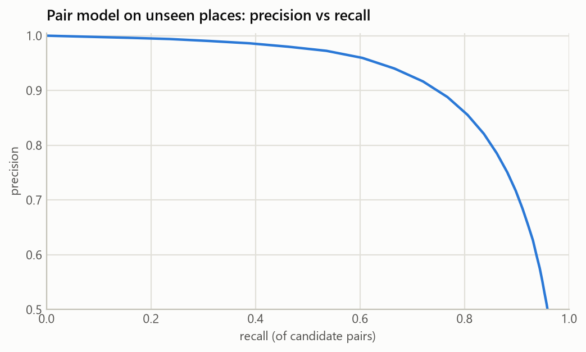

# Pair model benchmark on Foursquare Location Matching

Generated by `scripts/train/report_fsq.py` from the Kaggle kernel `kaggle/fsq_pair_model/` (CPU, 22 minutes, LightGBM stopped at 843 trees).
**Research benchmark only**: the data is under competition terms, so this model is not a shippable artefact. Its job is to show the stage-2 pair model works at scale on labelled data and to size the cascade.

## Setup

- 1,138,812 POI records of 739,972 real places, worldwide, all categories.
- Places (not records) are split 70 / 10 / 20 into train, validation and test worlds, so the test world holds only unseen places.
- Blocking inside each world: 10 nearest neighbours by distance, plus records sharing an exact normalised name in the same country.
- 23 pair features: distance, neighbour rank, six name similarities (character and word TF-IDF, Jaro-Winkler, token set / sort / partial), address, city, postcode, phone, website domain, category agreement, missing-field count.

## Test world results (places never seen in training)

| Measure | Value |
|---|---:|
| Records / true duplicate pairs | 227,706 / 195,276 |
| Candidate pairs after blocking | 1,547,084 (6.8 per record) |
| Records whose duplicate is reachable through blocking | 92.2% |
| Pair model AUC / average precision | 0.9876 / 0.9069 |
| **Cluster score (competition metric, mean IoU)** | **0.8783** |
| B-cubed precision / recall / F1 | 95.9% / 91.6% / 93.7% |
| Ceiling set by blocking (every reachable true pair accepted) | IoU 0.9593 |

The cluster threshold was chosen on the validation world and applied unchanged to the test world.

### Against rule baselines on the same candidates

| Method | Cluster IoU | B-cubed precision | B-cubed recall | B-cubed F1 |
|---|---:|---:|---:|---:|
| **LightGBM pair model** | **0.8783** | 95.9% | 91.6% | 93.7% |
| Rule: name_jw>=0.9 & dist<200m | 0.7362 | 98.8% | 74.8% | 85.1% |
| Rule: name_token_set>=0.9 & dist<500m | 0.7826 | 98.2% | 79.9% | 88.1% |
| Rule: exact normalised name & dist<1km | 0.7263 | 99.5% | 73.1% | 84.3% |

The model beats the best rule by **+0.096 IoU**. The rules are precise but leave most duplicates unmerged.

### Operating points (pair level)

| Target | Threshold | Precision | Share of reachable true pairs accepted | Pairs accepted |
|---|---:|---:|---:|---:|
| precision>=0.9 | 0.371 | 90.0% | 75.0% | 82,490 |
| precision>=0.95 | 0.596 | 95.0% | 63.7% | 66,460 |
| precision>=0.99 | 0.925 | 99.0% | 32.2% | 32,246 |
| precision>=0.995 | 0.966 | 99.5% | 20.4% | 20,315 |
| threshold=0.5 | 0.500 | 93.2% | 68.7% | 72,952 |

### Travel slice

| Slice (both records) | Candidate pairs | Matches | AUC | Avg precision | Recall at 99% precision |
|---|---:|---:|---:|---:|---:|
| lodging | 6,076 | 2,369 | 0.9736 | 0.9607 | 54.5% |
| attraction | 8,487 | 3,643 | 0.9634 | 0.9508 | 33.4% |

### How much the cheap model settles on its own

| Band | Share of candidate pairs |
|---|---:|
| Rejected with p < 0.02 | 87.3% |
| Accepted with p > 0.98 | 0.9% |
| Uncertain, passed to the next stage | 11.8% |

So about 88.2% of candidate pairs never need an expensive model. That share is what keeps cross-encoder and LLM cost proportional to hard cases, not to catalogue size.

## Feature importance (gain share)

| Feature | Share |
|---|---:|
| name_tfidf_char | 50.4% |
| dist_m | 8.7% |
| addr_token_set | 5.7% |
| cat_token_set | 5.6% |
| geo_rank | 5.1% |
| name_token_set | 4.7% |
| name_partial | 4.0% |
| n_missing | 1.9% |
| city_eq | 1.8% |
| name_len_min | 1.8% |

## Reading the numbers

- **Blocking is the binding constraint, not the classifier.** Only 92.2% of duplicate records are reachable, which caps the cluster score at 0.959; the model reaches 0.878. The next gain comes from a name-embedding candidate generator and a larger neighbour count, before any bigger model.
- **Pair-level recall looks low (50.7% of true pairs are candidates) because a few places have dozens of records.** A place with 100 records has 4,950 true pairs and a 10-neighbour search can cover a fraction of them. Clustering closes the rest transitively, which is why the per-record scores (IoU, B-cubed) are the fair measures.
- **Published context.** Winning entries of the 2022 competition scored about 0.95 IoU with several blocking generators, hundreds of features and transformer re-rankers (figure from memory of the public leaderboard; confirm before quoting). This single LightGBM is a first stage.
- **Label noise.** At 99% precision the model accepts 32.2% of reachable true pairs. The competition labels are known to contain errors, which depresses measured precision at the top of the ranking.
- Validation world for comparison: IoU 0.9003, B-cubed F1 94.9%.
