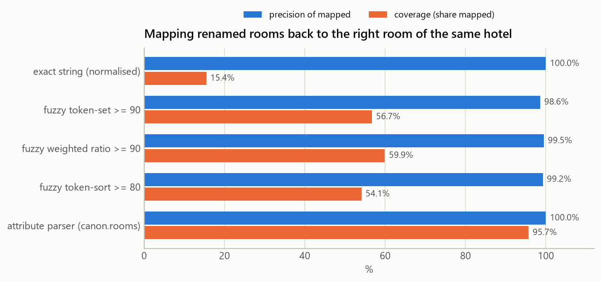

# Room and rate mapping: lexicon parser and synthetic-supplier benchmark

Generated by `scripts/train/rooms_benchmark.py`. Parser: `canon/rooms.py` (deterministic, no model calls).

## 1. Parser coverage on real room names

2,383 distinct Booking.com room names from 1,492 European hotels, weighted by how often each was booked.

| What the parser extracts | Share of distinct strings | Share of bookings |
|---|---:|---:|
| bed type found | 64.1% | 88.9% |
| class found | 65.2% | 69.8% |
| non-default room type (suite, apartment, ...) | 28.0% | 5.0% |
| view found | 16.7% | 3.6% |
| any feature (balcony, terrace, accessible, ...) | 16.4% | 3.5% |
| rate or package term split off | 9.5% | 1.4% |
| fully understood (no leftover tokens) | 57.5% | 91.7% |
| confident (score >= 0.8) | 69.0% | 94.1% |
| needs the model stage (score < 0.5) | 5.8% | 0.7% |

Most common leftover tokens (kept as part of the room's identity, and the input to the model stage): `two` (43), `eiffel` (40), `free` (39), `hilton` (33), `tower` (33), `park` (31), `sofa` (25), `pool` (25), `plus` (22), `lounge` (21), `disability` (20), `size` (18), `studio` (16), `duplex` (16), `city` (14), `art` (13), `shower` (13), `s` (13).

Indian OTA strings (6,003 distinct, MakeMyTrip + Goibibo): class, bed or type found in 89.9%; AC / non-AC in 36.2%; confident in 53.6%; 13.4% need the model stage.

## 2. What the room signature merges inside real hotels

Across the hotels, **207 pairs of different room names** in the same hotel get the same signature (room attributes equal once rate terms and occupancy wording are removed). By what differs between the two names:

| Difference between the two names | Pairs |
|---|---:|
| occupancy wording differs | 152 |
| rate / package / promotion differs | 43 |
| formatting only | 12 |

Examples:

| Kind | Hotel | Name A | Name B |
|---|---|---|---|
| formatting only | ADI Doria Grand Hotel | Two Connecting Rooms | Two Adjacent Rooms |
| formatting only | Hotel du Louvre in the Unbound Collection by Hyatt | Deluxe Twin | Deluxe Twin Room |
| formatting only | Hotel du Louvre in the Unbound Collection by Hyatt | Deluxe King Room | Deluxe King |
| rate / package / promotion differs | ARCOTEL Kaiserwasser Superior | Special Offer Comfort Double Room with Parking | Comfort Double Room |
| rate / package / promotion differs | ARCOTEL Wimberger | Comfort Double Room | Special Offer Comfort Double Room with Parking |
| rate / package / promotion differs | Austria Trend Hotel Europa Wien | Special Offer Classic Room | Classic Room |
| occupancy wording differs | Abba Sants | Double or Twin Room | Double or Twin Room 1 Adult |
| occupancy wording differs | Acta Atrium Palace | Triple Room 2 Adults 1 Child | Triple Room 3 Adults |
| occupancy wording differs | Ako Suites Hotel | Apartment 4 Adults | Apartment 1 2 Adults |

Rate-only differences are the intended merges (one room, two rate plans). Occupancy-only differences are one room sold at two occupancies, which belongs on the rate plan too. These are the pairs a string matcher keeps apart and a room/rate split puts together.

## 3. Synthetic second-supplier benchmark

**1,484 real hotels, 8,385 real rooms, six rewrite styles = 50,310 renamed strings.** Each must be mapped to the right room of its own hotel or left unmapped. Rooms of the same hotel are the distractors.

| Method | Coverage (share mapped) | Precision of mapped | Correct, as share of all |
|---|---:|---:|---:|
| exact string (normalised) | 15.4% | 100.0% | 15.4% |
| fuzzy token-set >= 90 | 56.7% | 98.6% | 55.9% |
| fuzzy weighted ratio >= 90 | 59.9% | 99.5% | 59.6% |
| fuzzy token-sort >= 80 | 54.1% | 99.2% | 53.7% |
| attribute parser (canon.rooms) | 95.7% | 100.0% | 95.7% |

By rewrite style (coverage / precision):

| Style | exact string (normalised) | fuzzy token-set >= 90 | fuzzy weighted ratio >= 90 | fuzzy token-sort >= 80 | attribute parser (canon.rooms) |
|---|---:|---:|---:|---:|---:|
| bedbank abbreviations | 1.1% / 100.0% | 13.9% / 98.5% | 14.1% / 98.9% | 17.9% / 98.8% | 95.7% / 100.0% |
| rate terms appended | 0.0% / 0.0% | 83.8% / 100.0% | 88.6% / 100.0% | 8.8% / 98.6% | 95.7% / 100.0% |
| comma style | 25.1% / 100.0% | 72.8% / 100.0% | 94.5% / 100.0% | 99.9% / 100.0% | 95.6% / 100.0% |
| case and punctuation noise | 18.6% / 100.0% | 88.2% / 99.9% | 84.8% / 99.9% | 99.7% / 99.9% | 95.8% / 100.0% |
| synonyms and bed phrasing | 47.9% / 100.0% | 76.8% / 94.5% | 74.8% / 97.9% | 84.6% / 97.7% | 95.7% / 100.0% |
| abbreviations + rate codes | 0.0% / 0.0% | 4.9% / 94.9% | 2.7% / 96.0% | 13.7% / 99.1% | 95.6% / 100.0% |

Rate extraction on the two styles that append rate terms: board basis and refundability recovered exactly in **100.0%** of 16,746 strings.

Examples the fuzzy matchers get wrong (renamed string -> chosen room, true room):

- `Comfort Room, 2 Single Beds` -> *Comfort Single Room* (true: *Comfort Twin Room*)
- `Superior Twin/Room with Double Bed` -> *Double Room* (true: *Superior Double or Twin Room*)
- `Superior Room, 2 Single Beds with Cathedral View` -> *Single Room* (true: *Superior Twin Room with Cathedral View*)
- `SUP STUDIO CV HB NRF` -> *Studio* (true: *Superior Studio with City View*)
- `Superior Room, 2 Single Beds` -> *Superior Room* (true: *Superior Twin Room*)
- `Room, 2 Single Beds with Private Bathroom` -> *Single Room with Private Bathroom* (true: *Twin Room with Private Bathroom*)

## Reading the numbers

- This is a **synthetic-supplier** result: the room lists and names are real, the second supplier is simulated by rewrite rules. It shows that attribute extraction survives abbreviation, re-ordering and glued-on rate terms where string similarity does not. It is not a measurement on TBO feeds; that needs real second-supplier room lists (Hotelbeds test keys, or a TBO sandbox).
- Unmapped strings are the precision-first design at work: when two rooms of a hotel share a signature, or the parser leaves tokens over, the string goes to the model stage instead of being guessed.
- Next: an LLM extraction stage for strings below the confidence bar, cached per unique string; then the price-band sanity check once offers exist.
