# Multi-Supplier Optimization: proposed architecture

Source: `ps/Multi Supplier Optimization.pdf` (one page, no data or rubric attached).
This document turns the statement into concrete ML tasks, proposes an architecture, and says how we would prove each part works.

---

## 1. What the statement is really asking for

| Statement text | Underlying task | Output |
|---|---|---|
| "Identify duplicate or equivalent attractions, tours, and experiences across suppliers" | Entity resolution at POI and product level | Canonical product IDs |
| "...while distinguishing products with different inclusions, such as transfers, meals, activity options, duration, access types, and cancellation policies" | Attribute extraction + typed relation classification | `SAME_AS` / `VARIANT_OF` / `INCLUDES` edges with an attribute diff |
| "Enable accurate product matching and comparison without losing meaningful differences" | Comparison view keyed on canonical product, variants grouped not merged | Product-family card with difference chips |
| "Identify and consolidate duplicate hotel listings across suppliers" | Property-level entity resolution and clustering | Canonical property IDs |
| "Map equivalent room types" | Room-level matching inside a property | Canonical room types |
| "Enrich property content and images" | Golden record, image dedup / quality / scene tagging, grounded descriptions | One curated content record per property |
| "Accurate comparison of bookable options based on price, availability, cancellation policies, payment terms, and supplier reliability" | Offer normalization, supplier reliability model, offer selection | Reliability-adjusted best offer per canonical room and rate class |
| "Optimize listing-page ranking" (both verticals) | Learning to rank with position-bias correction and duplicate-aware diversity | Ranked list of canonical cards |
| Objective: discoverability, price competitiveness, conversion | Business metrics | NDCG, duplicates in top-k, price competitiveness index, booking-rate uplift |

Reading it this way gives three design consequences.

1. **"Dedup" is the wrong mental model.** The data is a graph with typed edges at three levels:
   property → room type → rate plan for hotels, and attraction → product → option for sightseeing.
   Two "Burj Khalifa At the Top" listings from different suppliers can be identical, a variant (one adds hotel pickup),
   a superset (a combo that also includes Dubai Aquarium), or a different product (Level 148 vs Levels 124/125).
   Merging variants destroys exactly the differences the statement says must be kept.
2. **Room attributes and rate attributes are tangled in supplier strings.**
   "Deluxe King Sea View - Breakfast - Non Refundable" mixes the room (deluxe, king bed, sea view) with the rate plan (board basis, refundability).
   Room mapping only works after separating the two.
3. **Matching is the means; conversion is the end.** Judges will ask what changes on the listing page.
   The pipeline has to end in offer selection and ranking, and report metrics there.

The problem is real and measurable in public evidence. A GetYourGuide design case study curated 989 supplier-defined activities across eight points of interest into 404 canonical activities, a 59% reduction ([Behance case study](https://www.behance.net/gallery/101388501/GetYourGuide-Activity-Card-Redesign)).
GetYourGuide's own connectivity blog says about 35% of supplier product-mapping attempts ended in errors before they reworked their endpoints ([GetYourGuide connectivity blog](https://connectivity.getyourguide.com/blog/improved-product-mapping-with-our-new-api-endpoints)).

---

## 2. Positioning: work alongside Vervotech, own the gaps

TBO re-signed with Vervotech for AI-based hotel mapping in May 2026 ([Travel Weekly](https://travelweekly.com.au/tbo-renews-deal-to-clean-up-hotel-data-across-supplier-feeds/), [Travolution](https://www.travolution.com/news/tbo-strengthens-hotel-mapping-with-vervotech-and-ai/)).
Vervotech's TBO page claims 99.998% mapping accuracy ([Vervotech](https://www.vervotech.com/hub/master-suppliers/tbo/)); that is a vendor figure.

A hackathon entry that rebuilds property mapping from scratch competes with a vendor TBO already pays, and scores badly on "adoption risk".
The proposal therefore:

- **Ingests** any existing mapping IDs (Vervotech, GIATA, supplier cross-references) as a strong feature and prior, and routes disagreements to review rather than overriding them.
- **Concentrates** on what is thin or missing today: sightseeing product matching, room/rate disentanglement, offer arbitration with supplier reliability, and listing ranking.
- **Audits** mapping where errors cost money: high-traffic properties and pairs whose prices or coordinates disagree.
  Even 99.99% pairwise accuracy over millions of supplier records leaves thousands of wrong merges or splits, and each one can show a wrong price or fail a booking.

---

## 3. Architecture

```mermaid
flowchart LR
  subgraph INGEST[Ingest]
    S[Supplier feeds<br/>hotels, rooms, rates,<br/>activities, options] --> N[Normalize to canonical schema<br/>OCTO-shaped for activities]
    N --> DQ[Supplier data-quality profiler<br/>geocode precision, completeness]
  end
  N --> BL[Blocking<br/>H3 geo cells + name ANN + exact keys]
  DQ --> BL
  BL --> CAS[Scoring cascade<br/>Fellegi-Sunter → GBDT → cross-encoder → LLM → human]
  CAS --> CL[Constrained clustering<br/>+ stable ID inheritance]
  CL --> G[(Canonical Product Graph<br/>SAME_AS / VARIANT_OF / INCLUDES)]
  G --> RM[Room and rate mapping<br/>attribute extraction + matching]
  G --> SX[Sightseeing product and<br/>option relations]
  G --> GR[Golden record<br/>content + images + grounded text]
  RM --> OA[Offer arbitration<br/>reliability-adjusted effective price]
  SX --> OA
  OA --> RK[Listing ranking<br/>debiased LTR + duplicate-aware diversity]
  GR --> RK
  RK --> UI[Agent portal listing page]
  CAS -. uncertain pairs .-> HR[Review console]
  HR -. labels, active learning .-> CAS
  UI -. impressions, clicks, bookings .-> RK
```

| Layer | What it does | Main tools (licence) | Why this choice |
|---|---|---|---|
| Ingest and normalize | Map every supplier payload to one schema; parse addresses and phones; transliterate | libpostal (MIT), `phonenumbers` (Apache-2.0), ICU / `unidecode` | Matching quality is capped by normalization quality |
| Supplier data-quality profiler | Score each supplier's fields: coordinate precision, centroid geocodes, completeness, image counts | DuckDB (MIT) | Lets the matcher trust a precise supplier's coordinates and ignore a city-centroid supplier's |
| Blocking | Generate candidate pairs with near-perfect recall | H3 (Apache-2.0), FAISS (MIT) or hnswlib (Apache-2.0), Qwen3-Embedding-0.6B (Apache-2.0) | Pair scoring is cheap only if candidates per record stay small |
| Scoring cascade | Score pairs with the cheapest model that is confident | Splink (MIT), LightGBM (MIT), Qwen3-Reranker-0.6B (Apache-2.0), small open LLM with structured output | Cost scales with hard cases, not with catalogue size |
| Clustering and IDs | Turn pair scores into consistent entities with IDs that survive re-runs | Correlation clustering (a short pivot implementation over a NetworkX graph, BSD), Hungarian matching via SciPy (BSD) for ID inheritance | Transitivity errors and ID churn break downstream systems |
| Room and rate mapping | Extract attributes, separate room from rate, match within property | Lexicon + LLM extraction with JSON schema, cached per unique string | Room strings repeat across hotels, so LLM cost is per unique string |
| Sightseeing relations | Classify product pairs into typed relations with an attribute diff | Same cascade plus OCTO-shaped attribute schema | Keeps variants comparable instead of merged |
| Golden record | Field-level survivorship, image pipeline, grounded descriptions | imagehash (BSD-2), SigLIP 2 / DINOv2 (Apache-2.0) | One clean record per property, with provenance per field |
| Offer arbitration | Normalize price, policy and payment terms; model supplier reliability; pick the offer | Beta-Binomial shrinkage, LightGBM | "Cheapest" is not "best" once failures and price jumps are priced in |
| Ranking | Order canonical cards for conversion and margin, corrected for position bias | LightGBM LambdaMART (MIT) with inverse-propensity weights | Strong, fast, explainable, standard in travel search |
| Review console and governance | Human review queue, audit log, reversible merges, shadow mode | FastAPI (MIT), Postgres + PostGIS | Adoption needs control and rollback |

---

## 4. Components in detail

### 4.1 Ingestion and canonical schema

**Hotels**

- `Property`: names and aliases (multilingual), coordinates + H3 cell, parsed address, chain/brand, star rating, phone, website domain, amenities mapped to a fixed code list, images, provenance per field.
- `RoomType` (inside a property): room class (standard, superior, deluxe, premium, executive, club, junior suite, suite, villa, apartment), bed configuration (type and count), occupancy, view, size in m², features (balcony, private pool, connecting, accessible, smoking), location in building.
- `RatePlan`: board basis (RO, BB, HB, FB, AI), cancellation schedule as a penalty function of time, payment terms (prepay, pay at hotel, credit), inclusions (transfer, spa credit), restrictions (minimum stay, market or nationality).
- `Offer`: supplier, supplier hotel ID, supplier room code, rate plan, total price including taxes and fees, currency, availability count if supplied, timestamp, cache age.

Expedia's public lodging API enumerations are a usable starting vocabulary for bed types and sizes ([Expedia Group developer docs](https://developers.expediagroup.com/supply/lodging/docs/property_mgmt_apis/product/reference/enumerations/)).

**Sightseeing (shaped after OCTO)**

OCTO is the open connectivity standard for tours and activities. Its core objects are supplier, product, option and unit, with availability per product/option and cancellation cutoffs at option level ([OCTO docs](https://docs.octo.travel/); Klook's OCTO-style docs show the option/unit/cutoff fields in practice: [Klook OpenAPI](https://klook.gitbook.io/openapi/api-core-mandatory/products)).
Using its shape means real supplier feeds map in without a custom adapter per concept.

- `Attraction` (POI): names, coordinates, Wikidata QID when available, category, opening hours.
- `Product`: linked attraction(s) (one, or several for combos), experience type (entry ticket, guided tour, day trip, show, cruise, activity, transfer bundle).
- `Option`: duration, start times, languages, group type and maximum size, access type (standard, timed entry, skip-the-line, fast track, VIP), inclusions (hotel pickup/drop-off, meals, guide, entry fees, equipment), meeting point or pickup zone, cancellation cutoff and refund share, age bands.
- `Offer`: supplier, product and option codes, date and slot, unit prices, availability.

**Supplier data-quality profiler.** For each supplier, compute coordinate precision (decimal places, share of records on a city centroid, duplicate coordinates), field completeness, language mix and image counts.
The matcher uses these as features. A supplier that geocodes half its hotels to the city centre should not veto a match on distance.

### 4.2 Property and POI resolution

**Blocking (recall first).** Union of four candidate generators:

1. Same or neighbouring H3 cells at resolution 8 (about 0.7 km² per cell). For records the profiler flags as low-precision, fall back to city-level blocking on name tokens only.
2. Approximate nearest neighbours on character n-gram TF-IDF of the normalized name.
3. Approximate nearest neighbours on a multilingual embedding of `name | street | city`.
4. Exact keys: phone, website domain, email domain, existing vendor mapping ID.

Target: pair recall of 99.5% or better on the benchmark, with an average of fewer than 50 candidates per record.

**Pair features.** Haversine distance scaled by both suppliers' coordinate precision; Jaro-Winkler, token-set and transliteration-aware name similarities; embedding cosine; brand/chain agreement; star difference; address component matches (street number, postcode); phone, website and email-domain equality; image overlap (count of perceptual-hash matches within a small Hamming distance, maximum embedding similarity); amenity Jaccard; agreement with any vendor mapping; same-supplier flag.

Image overlap deserves attention: suppliers often receive photos from the same hotel marketing kit, so near-duplicate images across two listings are strong evidence of one property.

**Scoring cascade.** Each stage handles what it is confident on and passes the rest on.

| Stage | Model | Handles | Notes |
|---|---|---|---|
| 0 | Rules | Exact key matches, impossible pairs | Same phone and less than 200 m apart: auto-match. More than 5 km apart with precise coordinates: auto-reject |
| 1 | Splink (Fellegi-Sunter, EM-trained) | Bulk scoring with no labels | Gives calibrated match weights on day one ([Splink](https://github.com/moj-analytical-services/splink)) |
| 2 | LightGBM on the full feature set | Most remaining pairs | Trained on weak labels plus actively chosen human labels |
| 3 | Cross-encoder (fine-tuned multilingual reranker) | Text-heavy ambiguity: transliterations, renamed properties, brand changes | Qwen3-Reranker-0.6B is Apache-2.0 and covers 119 languages ([Qwen3 Embedding report](https://arxiv.org/abs/2506.05176)) |
| 4 | LLM adjudicator | The uncertain band only | Gets an evidence pack (both records, distance, image similarities) and returns decision, reason and the fields it relied on, as structured output |
| 5 | Human review | Whatever is still uncertain, prioritised by traffic | Labels feed back into stages 2 to 4 |

The cascade matters for cost. Peeters and Bizer found that the best LLMs match entities zero-shot about as well as fine-tuned BERT-style matchers trained on thousands of examples, and are more robust to unseen entities ([EDBT 2025, arXiv 2310.11244](https://arxiv.org/abs/2310.11244)).
That makes an LLM a good adjudicator. It is an expensive way to score millions of easy pairs.
For geospatial records specifically, GER-LLM pairs spatial blocking with group-wise LLM matching ([EMNLP 2025](https://aclanthology.org/anthology-files/pdf/emnlp/2025.emnlp-main.1186.pdf)), and Omni reports up to 12% F1 gains with geometry-aware encoders while finding LLMs competitive ([arXiv 2508.06584](https://arxiv.org/abs/2508.06584)).

**Clustering.** Build a graph whose edges carry match log-odds. Resolve it with correlation clustering, so that A=B and B=C with A≠C is settled once instead of chaining into a giant cluster.
Add cannot-link constraints (precise coordinates far apart, star ratings more than one level apart) and flag clusters that hold two records from the same supplier: those are either true supplier-internal duplicates or errors.

**Stable IDs.** Map each new cluster to the previous run's ID by maximum overlap (Hungarian matching), and keep redirects for merged IDs.
Overture's move to new GERS UUIDs produced 100% ID churn in one release ([Overture release notes, June 2025](https://docs.overturemaps.org/blog/2025/06/25/release-notes/)), which shows how disruptive unstable IDs are for anyone downstream.

### 4.3 Room and rate mapping

1. **Split and extract.** Parse every supplier room string and description into two attribute vectors: room attributes and rate attributes.
   A deterministic lexicon handles the common forms first (DBL, TWN, SGL, TRPL, DLX, SUP, STD, JR STE, SV, OV, CV, RO, BB, HB, FB, AI, NRF, multilingual equivalents).
   An LLM with a fixed JSON schema and enumerated values handles the rest.
   Results are cached on the normalized string. Room names repeat heavily across hotels ("Deluxe Double Room" appears everywhere), so LLM calls scale with the number of unique strings, not with the catalogue.
2. **Match inside the canonical property.** Hard constraints: bed configuration, view and occupancy must agree. Room class may differ by one step only with other strong evidence.
   Soft evidence: size within about 15%, amenity overlap, image similarity of room photos, embedding similarity of descriptions.
3. **Price-band sanity check.** On the same night, the same canonical room should price within a band across suppliers. An offer far outside the band is a likely mis-map or a different rate plan, and is flagged.
4. **Precision first.** Unmatched rooms stay separate. Showing two similar rooms costs a little choice clarity. Merging two different rooms causes booking disputes.

Commercial vendors describe the same attribute-driven approach (bed type, view, size, board basis, configurable strictness), though none publish models or benchmarks ([Gimmonix](https://gimmonix.com/news/how-does-room-mapping-work), [Nuitée Cupid](https://nuitee.com/cupid/room-mapping), [GIATA at ITB 2019](https://www.travolution.com/articles/110537/itb-2019-giata-unveils-algorithmic-approach-to-room-mapping)).
A published benchmark from us would therefore count as a contribution in its own right.

### 4.4 Sightseeing: product and option graph

1. **Anchor to attractions.** Link each product to one or more canonical attractions using geo, name and Wikidata QIDs. A combo links to several.
2. **Classify the experience type** (entry ticket, guided tour, day trip, show, cruise, activity).
3. **Extract option attributes** into the OCTO-shaped schema in 4.1, with the same lexicon-then-LLM pattern and caching.
4. **Classify pairs into typed relations.**

| Relation | Rule of thumb | Listing behaviour |
|---|---|---|
| `SAME_AS` | Same attraction set, same type, all key attributes equal (often the same operator resold by several suppliers) | Merge into one card; show offers from each supplier |
| `VARIANT_OF` | Same attraction set and type; differs only in whitelisted attributes (pickup, meal, language, duration, group size, access, cancellation) | Same product family; one card with variant selector and difference chips ("+ hotel pickup", "skip-the-line", "2 h shorter") |
| `INCLUDES` | Attraction set is a strict superset (combo) | Separate card, linked as "also includes" |
| `DIFFERENT` | Anything else | Separate cards |

Features: attraction-set Jaccard, type equality, the attribute difference vector, cross-encoder text similarity, operator identity (name, phone, meeting point), price ratio, image overlap.
Operator identity is the strongest single signal: the same local operator selling one tour through four resellers is the most common source of true duplicates.

### 4.5 Golden record: content and images

- **Field-level survivorship.** For each field, pick the value by source trust, recency and completeness, and keep provenance.
  Source trust is learned from how often each supplier agrees with the eventual consensus (a truth-discovery approach), not hand-set.
- **Images.** Perceptual hashes for exact and near duplicates; SigLIP 2 or DINOv2 embeddings for crops and recompressions.
  Quality score from resolution, blur (variance of the Laplacian), exposure, watermark/text overlay (OCR) and an aesthetic predictor.
  Scene tags (room, bathroom, lobby, pool, exterior, restaurant, view) by zero-shot SigLIP 2 prompts, optionally fine-tuned with Places365 categories.
  Assign images to canonical room types; choose a hero image per property and per room by quality with scene diversity.
- **Descriptions.** Generate text only from verified fields of the golden record, then check every sentence back against those fields and drop any unsupported claim.
  An invented "free airport shuttle" is a customer-service problem, so the measured target is zero unsupported claims in an audited sample.

### 4.6 Offer arbitration: reliability-adjusted effective price

For each canonical room and rate class, gather the live offers and compute a **reliability-adjusted effective price (RAEP)**:

$$
\text{RAEP}_o = P_o + F_o + p^{fail}_o \cdot C^{fail} + p^{chg}_o \cdot \mathbb{E}[\Delta P_o] - V^{flex}_o - V^{pay}_o
$$

- $P_o$, $F_o$: total price and fees in the agency's currency, with an FX buffer for cross-currency offers.
- $p^{fail}_o$: probability the prebook or booking fails; $C^{fail}$: cost of a failure (re-shopping at the next-best price, operations handling, agent goodwill).
- $p^{chg}_o$: probability of a price change at prebook. Price changes between search and prebook are a recognised failure mode in hotel booking APIs ([Gimmonix HSP docs](https://documentation.hsp.gimmonix.com/docs/gimmonix-transparent-pricing-system)), and the probability rises with cache age: availability and rates are typically cached for minutes, static content for days ([Traveloka partner FAQ](https://developer.travelokapartnersnetwork.com/faq)).
- $V^{flex}_o$: value of cancellation flexibility: probability of cancellation for this lead time and segment times the penalty avoided relative to the strictest alternative.
- $V^{pay}_o$: value of payment terms: credit days times TBO's cost of capital (negative for prepay).

**Supplier reliability model.** Track, per supplier × destination × property: prebook price-change rate, prebook and booking failure rates, confirmation latency, supplier-initiated cancellations and post-booking disputes.
Estimate them with hierarchical Beta-Binomial shrinkage, so a property with little history borrows strength from its supplier and destination, and with exponential recency weighting.
Where volumes allow, a LightGBM model adds lead time, rate type and cache age.

**Selection.** Choose the minimum-RAEP offer, break ties on TBO margin, and keep the alternatives under the same card with a one-line reason ("Supplier B: +₹180, but supplier A failed 6% of prebooks here this month").
Report a **price competitiveness index**: the share of canonical rooms where TBO's displayed price is at or below the reference market price (best competitor rate if rate-shopping data exists, otherwise the best integrated-supplier rate).

### 4.7 Listing-page ranking

1. **Candidates are canonical cards, not supplier listings.** A property with offers from five suppliers is one card showing "best offer + 4 more".
2. **LambdaMART (LightGBM)** on features covering relevance (distance to the searched area or POI, star and price fit to the agency's history), quality (reviews, content completeness, image quality), price (RAEP vs. market, discount vs. the property's own historical price), availability depth, cancellation flexibility, supplier reliability, smoothed popularity and conversion, B2B personalisation (the agency's past bookings by star, brand, area and segment), and context (lead time, length of stay, party size, weekend).
3. **Position-bias correction.** Logged clicks and bookings favour whatever was ranked high before. Estimate the position propensities and weight training examples by inverse propensity (Unbiased LambdaMART: [Hu et al. 2019](https://arxiv.org/abs/1809.05818)).
   Tripadvisor showed in online A/B tests that handling position bias improved hotel ranking ([Li 2020, arXiv 2002.12528](https://arxiv.org/abs/2002.12528)); Airbnb treats position as a regularised control variable instead ([Haldar et al. 2020, arXiv 2002.05515](https://arxiv.org/abs/2002.05515)).
   The public Expedia ICDM 2013 data includes a flag for searches shown in random order (about 30% of searches), which allows clean propensity estimates and unbiased offline evaluation.
4. **Final score and diversity.** Score = calibrated P(book) × (margin + β·GMV), then a diversity pass over area, price band and brand. Products of one family collapse into a single card.
5. **Exploration.** Reserve a few slots per page for new or under-exposed canonical entities, chosen by Thompson sampling, so new supply can build a track record.
6. **Sightseeing ranking** uses the same machinery with extra features: attraction popularity (Wikipedia pageviews are a free proxy), inclusions value, duration fit, instant confirmation, free cancellation, language availability and price per hour.

### 4.8 Human review, governance and cost

- **Thresholds per action.** Auto-merge only above a calibrated threshold set for at least 99.9% precision; send the middle band to review; auto-reject below. Thresholds are configuration, versioned and audited.
- **Review console.** Side-by-side diff of the two records, map, photo pairs, the model's reasons, and one-click merge/split/variant. Every decision is logged and reversible.
- **Shadow mode.** Run on live traffic, compare with the current listing page, and switch per destination once metrics hold.
- **Cost model.** LLM calls ≈ unique room/option strings + pairs in the uncertain band. We will measure and report calls and cost per 1,000 supplier records, and keep the model provider a configuration value, so swapping it needs no code change. (The DarwinBox statement in `ps/` scores teams on exactly this kind of measured cost and provider independence, which suggests TBO judges value it.)
- **Latency.** Ranking ~200 candidates with LightGBM plus offer arbitration fits a budget of tens of milliseconds. Matching is offline and incremental.

---

## 5. How we prove it works

| Component | Metric | Benchmark | Prototype target |
|---|---|---|---|
| Property and POI matching | Pairwise precision and recall; B³ F1 for clusters | Multi-source city benchmark (section 6) with a held-out city; Foursquare Location Matching for research comparison | Precision ≥ 99.5% at recall ≥ 95% on the held-out city |
| Room mapping | Precision at a stated coverage | Hand-labelled rooms for about 100 properties, plus synthetic supplier renamings | ≥ 97% precision at ≥ 85% coverage |
| Sightseeing relations | Macro-F1 over the four relation types; family purity | Labelled pairs for 30 to 50 attractions in two cities | Macro-F1 ≥ 0.85 |
| Content | Duplicate-image rate; share of hero images above the quality bar; unsupported-claim rate in generated text | Audited sample | Zero unsupported claims in the audit |
| Offer arbitration | Expected cost and failures avoided vs. a cheapest-price rule | Simulation with supplier reliabilities calibrated to plausible ranges | Reported with confidence intervals |
| Ranking | NDCG@5 (booking = 5, click = 1, as in the original competition); IPS-estimated booking rate; duplicates in top 10; unique properties in top 10 | Expedia ICDM 2013, including the randomised slice, plus a variant with injected cross-supplier duplicates | Beat both Expedia's logged order and a LambdaMART without debiasing |
| Cost | LLM calls and ₹ per 1,000 records; share of pairs resolved at each cascade stage | Pipeline logs | Reported as measured |

The targets are what we would aim for; they are not results yet.

---

## 6. Data plan

No dataset comes with this statement (and a competing team's repository says "No dataset was provided" for the inventory statement).
We build a benchmark from real, independent sources so the numbers are credible. Full catalogue in [`04-datasets.md`](04-datasets.md).

1. **Real multi-source hotel and attraction benchmark.** Pick two or three TBO-relevant cities (for example Dubai, Bangkok, Singapore) and pull hotels and attractions from sources that were built independently:
   OpenStreetMap, Overture Maps Places (CDLA-Permissive-2.0), Foursquare OS Places (Apache-2.0), Wikidata and Wikivoyage listings.
   Each source behaves like a "supplier" with its own naming, geocoding and completeness habits.
   Weak labels come from shared Wikidata QIDs, OSM `wikidata` tags, website domains and phones; a few thousand human labels come from active learning in the review console.
2. **Real supplier-shaped content.** Hotelbeds evaluation keys (test environment, 50 requests per day: [Hotelbeds docs](https://developer.hotelbeds.com/documentation/)) for hotel and room content, and Viator's free Basic Access affiliate API for attraction and product content ([Viator affiliate API](https://docs.viator.com/partner-api/affiliate/technical)).
   Amadeus's self-service APIs are no longer an option: the self-service portal closed in July 2026 ([PhocusWire](https://www.phocuswire.com/amadeus-shut-down-self-service-apis-portal-developers)).
3. **Synthetic supplier feeds with known truth.** Start from canonical real entities and generate supplier views with controlled perturbations: brand-suffix removal, transliteration, abbreviations, typos, geo jitter by supplier profile, room-name rewrites using real naming patterns, option variants (pickup, meals, language, duration, cancellation), and supplier-specific markups, failure rates and price-change rates.
   This is the only way to measure offer arbitration end to end.
4. **Ranking logs.** Expedia ICDM 2013 (about 9.9M impressions over about 400k searches, with competitor price and availability fields and a random-order flag) for LTR and debiasing.
   We also make a copy with injected cross-supplier duplicates to measure the effect of collapsing them.
5. **Images.** Hotels-50K (about 1.03M images of 50,000 hotels with chain and location) and Hotel-ID for training and testing image-based hotel matching.

---

## 7. Demo storyboard (about 5 minutes)

1. **The mess.** A Dubai search on a mock agent portal fed by four "suppliers": three cards for the same resort at different prices, two near-identical Burj Khalifa tickets, room names nobody can compare.
2. **Matching with evidence.** Run the pipeline. A map shows the clusters; click one to see distance, name similarity, matching photos and the score at each cascade stage. One borderline pair shows the LLM's structured reasoning, then a human confirms it in the review console.
3. **Room matrix.** One hotel: four suppliers' room strings become canonical rooms, with attribute chips, and the rate parts (breakfast, non-refundable) split off.
4. **Offer arbitration.** Same canonical room, four offers. The cheapest loses to one ₹180 dearer because its supplier failed 6% of prebooks here; the reason is shown.
5. **Sightseeing families.** Nine supplier products for one attraction become three families with variant chips ("+ hotel pickup", "Level 148", "skip-the-line").
6. **Ranking.** Before/after listing page; the metric panel shows NDCG, duplicates in the top 10 and the price competitiveness index; switching the agency persona (luxury vs. budget) reorders results.
7. **Operations.** Review queue, audit log, cost per 1,000 records, share of pairs resolved at each stage.

---

## 8. What is new here

- A **typed relation graph** (`SAME_AS`, `VARIANT_OF`, `INCLUDES`) instead of binary deduplication. This is what "without losing meaningful differences" requires.
- **Room/rate disentanglement** before matching, with a price-band sanity check that catches mis-maps.
- **Reliability-adjusted effective price** for supplier selection, which makes "supplier reliability" from the statement a priced quantity rather than a label.
- A **cost-aware cascade** in which LLM spend scales with unique strings and hard pairs, measured and reported.
- **Grounded content generation** with sentence-level verification, so enrichment cannot invent amenities.
- **Debiased, duplicate-aware ranking** over canonical cards, with B2B agency personalisation.
- **Stable IDs** across re-runs, and a design that works with TBO's existing mapping vendor rather than against it.

---

## 9. Risks and mitigations

| Risk | Mitigation |
|---|---|
| Judges say "Vervotech already does this" | Lead with sightseeing, offers and ranking; present hotel matching as an audit and fill-in layer that consumes vendor IDs |
| Benchmark too easy (sources agree) | Hold out a whole city; report on the hardest slices (transliterated names, centroid geocodes, renamed properties) |
| LLM cost or latency | Cascade with caching; small open models by default; provider set in configuration |
| Licences | Train shippable models only on commercially usable data (Apache, CDLA, CC BY, ODbL with attribution); keep research-only sets for benchmarking (see `04-datasets.md`) |
| "Mostly tables" demo | Before/after listing page, map clusters, photo evidence, difference chips: the storyboard above is built to be visual |
