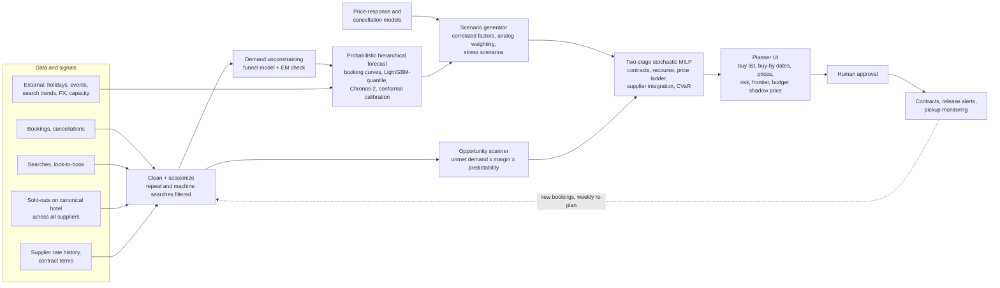

# Automated Inventory Optimization: proposed architecture

Source: `ps/Automate Inventory Optimization.pdf` (one page, no data attached; "System will be provided with maximum input budget").
This document restates the problem as decisions under uncertainty, proposes an architecture, gives the optimization model, and says how we would prove it.

---

## 1. What the statement asks for

| Statement text | What it means for the system |
|---|---|
| "maximize availability by making smarter travel inventory procurement decisions" | Availability is an objective in its own right, not only profit. Lost sales to sold-outs must carry a cost |
| "analyzes historical bookings, demand trends, sold outs, look to book, seasonality and external signals" | Data layer that turns bookings and searches into *true* demand, plus external drivers |
| "identify inventory to target to maximize expected profit" | Opportunity discovery: which hotel, route, destination and travel period |
| "optimize budget allocation across hotels, flights, destinations, and travel periods" | Portfolio optimization under a hard budget |
| "accounting for demand fluctuations, pricing changes, cancellations, and unsold inventory risks" | Stochastic demand, rate dynamics, cancellation model, salvage value |
| "plan pre buy, supplier integration and pricing to maximise bookable inventory" | Three levers: buy inventory up front, integrate new suppliers, set selling prices |
| Key objectives: predict demand; identify opportunities; optimize investments; maximize profitability via "optimal purchase timing, inventory quantities, and selling prices"; manage risk | Forecasting, opportunity scoring, allocation, timing, pricing, risk control |
| Expected outcome: a decision-support platform for "risk-adjusted profits" within a given maximum budget | Recommendations with risk numbers, explanations and human approval |

## 2. Why this is harder than "forecast, then knapsack"

1. **Observed demand is censored.** When a hotel sells out, bookings stop even though people keep searching. Training on bookings teaches the model that demand is lowest exactly when it is highest.
   Unconstraining is a known revenue-management problem: in airline studies, naive methods degrade badly once more than about 20% of observations are censored, and EM and projection-detruncation methods did best ([Weatherford and Pölt 2002, as summarised by Babić et al.](https://doisrpska.nub.rs/index.php/economyandmarket/article/view/6511)).
2. **Searches are not demand.** Look-to-book ratios in hotel distribution are reported anywhere from about 500:1 to 20,000:1, driven by metasearch, caching and scraping ([Hospitality Net opinion](https://www.hospitalitynet.org/opinion/4074433.html)).
   Raw search counts in a B2B API business mostly measure machine traffic. Searches need sessionizing, de-duplication and channel weighting before they mean anything.
3. **"Sold out" must be measured on the real hotel, across all suppliers.** A hotel that is sold out on one supplier and available on three others is not sold out.
   Measuring true sell-outs needs the cross-supplier mapping from the Multi-Supplier statement. The two statements share this foundation, and saying so is a strong pitch point.
4. **Inventory comes as contracts, not units.** Hotels sell hard pre-buys (non-refundable), allotments that can be released back by a cut-off date, and free sale at higher net rates.
   Release periods are typically days to weeks before arrival ([Wikipedia: Allotment (travel industry)](https://en.wikipedia.org/wiki/Allotment_(travel_industry)), [Roommaster on blocks, cut-offs and wash](https://www.roommaster.com/blog/hotel-allotment-management)).
   Flights come as group or series blocks with deposits and name-list deadlines.
   The decision is a portfolio of options with recourse, not one quantity per item.
5. **The levers interact.** Selling price changes demand. Two blocks in substitutable hotels cannibalise each other. Flight and hotel blocks for the same destination complement each other.
   A new supplier changes how much free-sale top-up is available. Buying earlier is cheaper but less informed.

The academic literature on this exact setting is thin. The closest work studies tour operators' at-risk (take-or-pay) rooms ([Cornell eCommons](https://ecommons.cornell.edu/server/api/core/bitstreams/7dccb5bf-27f0-4a54-97e2-4a450d38a513/content)), and a camping revenue-management paper finds that bid-price approaches using continuous relaxations behave poorly for allotment decisions, while a Lagrange decomposition works better ([IAOR record](https://iaorifors.com/paper/96553)).
That supports solving the combinatorial stochastic program directly rather than through bid prices.

---

## 3. Architecture

| Layer | Purpose | Main tools (licence) |
|---|---|---|
| Clean and sessionize | Turn raw search logs into demand-relevant sessions; tag channel (portal vs API) | DuckDB (MIT), pandas |
| Unconstraining | Estimate demand lost to sell-outs | LightGBM (MIT) conversion model; EM baseline |
| Forecasting | Distribution of unconstrained net demand by item and stay week at each lead time | StatsForecast / MLForecast / HierarchicalForecast (Apache-2.0), LightGBM quantile, Chronos-2 (Apache-2.0), MAPIE (BSD-3) |
| Price response and cancellations | Demand at each price level; probability and timing of cancellation | EconML (MIT) or DoubleML for elasticities; LightGBM |
| Scenario generation | Joint demand, rate and availability scenarios with realistic correlation and tail events | NumPy/SciPy, k-medoids scenario reduction |
| Optimization | Choose contracts, quantities, prices, suppliers and timing under budget and risk limits | HiGHS (MIT) via Pyomo (BSD) or linopy; OR-Tools (Apache-2.0) as alternative |
| Decision support | Explain, compare, stress-test, approve | FastAPI (MIT), web UI; LLM analyst that calls the engine as a tool |

---

## 4. Components in detail

### 4.1 Data and signals

| Input | Cleaning |
|---|---|
| Bookings: stay dates, lead time, rate type, ADR, agency, channel | Net of cancellations; keep cancellation timing |
| Searches and look-to-book | Sessionize by agency × destination × dates × party within a time window; drop machine and cache-refresh traffic; weight portal and API channels separately |
| Sold-outs | Measured on the canonical hotel (union of supplier availability), per night |
| Supplier rates and contracts | Net rate by lead time; contract type, release date, deposit, minimum use |
| External | Indian and destination holidays and festivals, school vacations, events, search trends (Google Trends API alpha or Wikipedia pageviews), air capacity, FX, travel advisories |

### 4.2 Demand unconstraining

For canonical hotel $h$ and stay night $d$, fit a conversion model on periods when the hotel was available:
$\Pr(\text{book} \mid \text{available}, x_j)$, where $x_j$ describes search session $j$ (lead time, length of stay, party, price competitiveness, agency).
In sold-out periods, impute demand as $\hat D_{h,d} = \sum_j \Pr(\text{book} \mid \text{available}, x_j)$, using the last available price.

Check it two ways. First, against EM and projection detruncation, the methods that did best in Weatherford and Pölt's comparison. Second, on simulated data with planted true demand: censor it at artificial capacities, then measure how much demand each method recovers.
The second check is only possible because the simulator knows the truth.

### 4.3 Probabilistic, hierarchical forecasting

- **Target.** The distribution (not just the mean) of unconstrained net demand per item and stay week, at each decision lead time $L$.
  The optimal newsvendor quantity is a quantile of demand set by price, cost and salvage value, so the decision needs the tail, not only the median.
- **Booking curves.** Final demand = on-the-books at lead time $L$ + pickup from $L$ to arrival. Pickup models are the standard hotel revenue-management approach and give forecasts that sharpen as the stay date approaches.
- **Models, in an ensemble judged by backtest.**
  - Baselines: seasonal naive, ETS and Theta (StatsForecast).
  - A global LightGBM quantile model across all series, with lags, pickup features, holidays, events, trends and FX.
  - Chronos-2 zero-shot with known covariates. It is a 120M-parameter, Apache-2.0 model that supports past-only, known-future and categorical covariates; its technical report puts it ahead of TimesFM-2.5 and Moirai-2.0 on GIFT-Eval ([arXiv 2510.15821](https://arxiv.org/abs/2510.15821), [Amazon Science blog](https://www.amazon.science/blog/introducing-chronos-2-from-univariate-to-universal-forecasting)). These are the authors' own numbers.
- **Calibration and coherence.** Conformalized quantile regression so that P10 to P90 bands really cover about 80%; MinT reconciliation so that hotel, destination and region forecasts add up.
- **Cancellations.** $\Pr(\text{cancel} \mid \text{lead time, rate type, deposit, market, agency})$ and the timing of cancellations. The Antonio et al. hotel dataset is built for exactly this. Net demand falls, and cancelled rooms come back for resale.
- **Price response.** Conversion as a function of TBO's price relative to alternatives, estimated with double machine learning.
  A naive regression gets the sign wrong because prices rise when demand is high. The output is demand at each price level $k$ on a ladder of markups.

### 4.4 Scenario generation

- **Correlation.** Forecast residuals share global, regional, destination and seasonal factors. Fit a factor model (or block-bootstrap historical residual vectors) so that a bad season hits many items at once, as it does in reality.
- **Context weighting.** Weight historical scenarios by how similar their context is to today's, using random-forest weights in the style of Bertsimas and Kallus' "predictive prescriptions".
  Their method stays asymptotically optimal even with censored data ([Management Science 2020, arXiv 1402.5481](https://arxiv.org/abs/1402.5481)).
- **Stress scenarios inside the model.** Travel advisory for a destination, airspace closure, a festival date shift, an FX shock, a supplier failure. These carry explicit probabilities, so they affect CVaR rather than sitting on a separate slide.
- **Scenario reduction.** k-medoids down to about 200 representative scenarios keeps the optimization fast.

### 4.5 Opportunity scanner

Score candidate items (canonical hotel or hotel group × stay window; route × departure window) by expected unmet demand × expected unit margin × predictability (inverse forecast spread) × contract availability, then explain each score in words from its drivers.
Example output: "Dubai, 18-31 Dec: 23% of qualified searches hit a sell-out across all suppliers last year; net rates rose 38% inside 21 days of arrival; P50 demand 1,240 room-nights."
(Illustrative wording, not a result.)

### 4.6 Optimization model

**Sets.** $i \in \mathcal{I}$ candidate items; $k \in \mathcal{K}_i$ price levels; $\omega \in \Omega$ scenarios with probabilities $\pi_\omega$; $s \in \mathcal{S}$ candidate suppliers to integrate.

**First-stage decisions (now).**
$x^h_i \ge 0$ hard pre-buy units at unit cost $c^h_i$;
$x^a_i \ge 0$ allotment units at unit cost $c^a_i$ with deposit share $\delta_i$, releasable at the cut-off;
$y_{ik} \in \{0,1\}$ price level, with $\sum_k y_{ik} = 1$;
$z_s \in \{0,1\}$ integrate supplier $s$ at fixed cost $F_s$.

**Recourse decisions (per scenario).**
$r_i(\omega)$ allotment units released at the cut-off;
$t_i(\omega)$ free-sale top-up bought close to the stay at cost $c^f_i(\omega)$;
$q_{ik}(\omega)$ units sold at price level $k$;
$e_i(\omega)$ unsold committed units, salvaged at $v_i$;
$\ell_i(\omega)$ unmet demand.

**Constraints.**

$$
\begin{aligned}
& q_{ik}(\omega) \le D_{ik}(\omega)\, y_{ik} && \text{demand at the chosen price}\\
& \textstyle\sum_k q_{ik}(\omega) + e_i(\omega) = x^h_i + x^a_i - r_i(\omega) + t_i(\omega) && \text{inventory balance}\\
& 0 \le r_i(\omega) \le (1-u_i)\, x^a_i && \text{release, with minimum-use share } u_i\\
& t_i(\omega) \le A_i(\omega) + \textstyle\sum_s G_{si}(\omega)\, z_s && \text{free-sale supply, extended by new suppliers}\\
& \ell_i(\omega) = \textstyle\sum_k \big(D_{ik}(\omega)\, y_{ik} - q_{ik}(\omega)\big) && \text{lost demand}\\
& \textstyle\sum_i \big(c^h_i x^h_i + \delta_i c^a_i x^a_i\big) + \sum_s F_s z_s \le B && \text{budget}\\
& \textstyle\sum_{i \in \mathcal{I}_g} \big(c^h_i x^h_i + c^a_i x^a_i\big) \le \kappa_g B && \text{exposure caps per destination, supplier, currency, month}
\end{aligned}
$$

Releases are decided at the cut-off, before final demand is known. To respect that, group scenarios into bundles that look the same at the cut-off (same pickup-to-date signal) and force $r_i(\omega)$ to be equal within a bundle.
This is a small scenario tree rather than a two-stage model with perfect hindsight, which would overstate the value of allotments.

**Profit in scenario $\omega$.**

$$
\Pi(\omega) = \sum_i \Big[\sum_k p_{ik}\, q_{ik}(\omega) + v_i\, e_i(\omega) - c^h_i x^h_i - c^a_i\big(x^a_i - r_i(\omega)\big) - c^f_i(\omega)\, t_i(\omega) - g_i\, \ell_i(\omega)\Big] - \sum_s F_s z_s
$$

$g_i$ is a goodwill cost per unmet booking. It is how "maximize availability" enters the objective: an agency that sees a sell-out on TBO books elsewhere and may not come back.
An alternative is an explicit fill-rate constraint for strategic markets. Showing the profit-availability frontier lets TBO choose.

**Risk-adjusted objective (Rockafellar-Uryasev CVaR).**

$$
\max \;\; \sum_\omega \pi_\omega \Pi(\omega) \;-\; \lambda \Big(\eta + \frac{1}{1-\alpha} \sum_\omega \pi_\omega\, \xi_\omega\Big)
\quad \text{s.t.} \quad \xi_\omega \ge -\Pi(\omega) - \eta,\;\; \xi_\omega \ge 0
$$

At the optimum, the bracket equals $\mathrm{CVaR}_\alpha$ of the loss, the average loss in the worst $(1-\alpha)$ share of scenarios ([Rockafellar and Uryasev 2000](https://doi.org/10.21314/JOR.2000.038); for the newsvendor case, [Gotoh and Takano 2007](https://ideas.repec.org/a/eee/ejores/v179y2007i1p80-96.html)).
Sweeping $\lambda$ traces the risk-return frontier. A finance team may prefer the equivalent constraint form: maximize expected profit subject to $\mathrm{CVaR}_{95\%}$ ≤ an agreed loss limit.

CVaR is preferred over a mean minus λ·standard-deviation objective because standard deviation penalises upside surprises as much as losses. CVaR only penalises the bad tail, which is what a budget holder actually worries about.

**Size and solver.** All products of data and binaries are linear, so this is a mixed-integer linear program; the only integers are $y$ and $z$.
With 150 items, 5 price levels and 200 scenarios it has a few hundred thousand continuous variables and under a thousand binaries, a size HiGHS (MIT licence) handles.
Larger instances decompose by destination, because the budget, the exposure caps and the CVaR term are the only couplings.

**Stretch extensions.** Substitution: spill variables move a share $\theta_{ij}$ of lost demand from item $i$ to a substitute $j$ in the same destination and tier.
Packages: package demand consumes one seat and one room bundle at the same time, linking flight and hotel blocks.

**Outputs.** Buy list (item, contract type, quantity, maximum acceptable net rate, buy-by date), price ladder per item, expected profit with P10/P50/P90, CVaR, probability of loss, expected fill rate, contribution of each item to tail risk, and the **shadow price of the budget**: the risk-adjusted profit from one more rupee of budget. The shadow price tells management directly whether the budget is the binding constraint.

### 4.7 Purchase timing

Decision epochs at, say, 120, 90, 60, 45, 30, 21 and 14 days before stay. For each candidate:

- net rate rises as the stay approaches (strongly for peak dates), learned from supplier rate histories;
- the chance that a contract is still on offer falls;
- forecast uncertainty shrinks.

Evaluate the risk-adjusted value of committing at each epoch and recommend **buy now / wait / watch** with a **buy-by date**, the last epoch before value drops materially.
Allotments with a release clause act as cheap options that let TBO commit early without bearing the full risk. The model prices that option instead of ignoring it.
Re-optimize weekly on a rolling horizon with past commitments fixed.

### 4.8 Supplier integration

Candidate suppliers come with coverage estimates from the canonical inventory graph: for each item, the share of TBO's sell-out nights on which supplier $s$ had availability, $G_{si}(\omega)$.
$F_s$ includes integration and certification effort. The model then answers questions like "integrate supplier X for Bali: covers about a third of July-August sell-out room-nights, pays back within a season" (illustrative), comparable on the same scale as pre-buying.

### 4.9 Decision support

- **Planner UI.** Opportunity heat map (destination × month), buy list with reasons, price ladder, risk panel (profit histogram, CVaR, probability of loss), risk-appetite slider over the frontier, budget shadow price, stress-test toggles, and after purchase a pickup monitor (actual vs. forecast) with release-date alerts.
- **LLM analyst.** Answers "what if the budget is ₹10 crore", "exclude the Gulf", "why Bali?" by calling the forecasting and optimization engine as tools.
  Every number comes from the engine; the LLM only phrases it. It can draft a memo for the procurement committee but cannot commit money. Approvals are logged.

---

## 5. How we prove it works

| Layer | Metric | Data |
|---|---|---|
| Forecast | WAPE; pinball loss / CRPS; P10-P90 coverage; by hierarchy level and lead time | Real public series (Antonio et al. hotel bookings, Monash tourism series, Eurostat nights, BTS T-100) and the calibrated simulator |
| Unconstraining | Share of censored demand recovered vs. planted truth; comparison with EM and projection detruncation | Simulator; real hotel data with artificial capacity caps |
| Decisions | Realised profit and ROI, sell-through, fill rate, CVaR 5%, probability of loss, regret vs. a perfect-information plan | Rolling-origin backtest over several simulated seasons, re-planning weekly |
| Value of modelling choices | VSS (stochastic plan vs. a deterministic plan on P50 demand, both evaluated on the scenarios); EVPI | Same backtest |
| Ablations | Remove unconstraining, the price decision, allotments, CVaR (use mean - λ·SD), supplier integration | Same backtest |

Baselines: last year's volume; greedy by expected return per rupee; independent newsvendor per item followed by a knapsack; a deterministic LP on P50 demand.

---

## 6. Data plan: a simulator calibrated on real public data

TBO's own data will not be available, so we build a TBO-like simulator whose parameters come from real datasets, and plant known true demand in it.
Each parameter's source is named, so judges can see what is real and what is assumed. Full catalogue in [`04-datasets.md`](04-datasets.md).

| Simulator component | Calibrated from |
|---|---|
| Lead-time distribution, cancellation rates by lead time and deposit type, ADR seasonality | Antonio et al. hotel booking demand (119,390 bookings, two Portuguese hotels, 2015-2017) |
| Search-to-booking funnel and destination × check-in seasonality | Expedia Hotel Recommendations (Kaggle 2016, about 38M click and booking events) |
| Price response relative to competitors | Expedia ICDM 2013 (competitor price and availability fields per impression) |
| Fare curves against days to departure and seats remaining | Expedia FlightPrices 2022 (`seatsRemaining`, `totalFare`, search and flight dates); EaseMyTrip India 2022 (`days_left`, about 300k rows) |
| Market seasonality and capacity | Eurostat nights spent at tourist accommodation; India Ministry of Tourism monthly snapshots (foreign arrivals, Indian national departures); BTS T-100 seats and passengers; DGCA monthly traffic |
| Compression nights (when markets sell out) | STR SHARE Center (academic access) if obtainable; otherwise Inside Airbnb calendars as a proxy |
| Events and holidays | `holidays` Python library; PredictHQ via Dewey (academic access) |

---

## 7. Differentiation from the visible competitor

At least one team has already published a polished system for this statement: [Allotment Atlas](https://github.com/shanshantanusingh113-max/allotment-atlas) (public repository, created 28 October 2026).
Read from its README and docs through GitHub code search, it includes a synthetic generator (28 destinations, six Indian hubs), weekly P10/P50/P90 quantile gradient boosting with conformal bands (WAPE 9.0% vs. 11.2% for a naive baseline on its synthetic data), newsvendor sizing per block, a grouped-knapsack optimizer on expected profit minus λ·SD, buy-timing curves, correlated Monte Carlo reporting CVaR afterwards, a 3D globe and plain-English commands.
It is a strong entry, and we should assume several others look similar.

| Aspect | Allotment Atlas (public repo, early Nov 2026) | This proposal |
|---|---|---|
| Data | Synthetic only ("No dataset was provided") | Simulator calibrated on named real datasets, with planted truth to measure unconstraining |
| Demand | Bookings + searches lost to sell-out | Funnel model with machine and repeat-search filtering, sell-outs measured on the canonical hotel across suppliers, checked against EM |
| Decision structure | Newsvendor per block, then knapsack | Joint stochastic MILP over hard pre-buy, allotment with release, and free-sale top-up |
| Risk | Mean - λ·SD in the optimizer; CVaR reported after | CVaR optimized directly; stress scenarios inside the model |
| Pricing | Selling price per block | Price ladder chosen jointly with quantities from an estimated price-response curve |
| Supplier integration | Not modelled | Binary integration decision with coverage-gap benefit |
| Contract terms | Listed as future work | Core of the model, including release-option value |
| Proof | Backtest WAPE; plan vs. greedy rule | Also VSS, EVPI, regret vs. perfect information, ablations |

---

## 8. Demo storyboard (about 5 minutes)

1. **The question.** "₹8 crore to commit for next year's peaks: what should TBO buy, how much, when, and at what price?"
2. **True demand.** One destination's history: bookings flatten during sell-outs while qualified searches keep rising; the unconstrained demand line appears, with the share recovered.
3. **Opportunity map.** Destinations × months heat map with reasons.
4. **The plan.** Buy list mixing hard blocks, allotments and "integrate supplier X"; price ladder; buy-by dates.
5. **Risk.** Profit histogram, CVaR, probability of loss; slide risk appetite and watch the plan change; switch on a "travel advisory" stress and see what the plan already hedged.
6. **Proof.** Backtest against the baselines, with VSS and regret.
7. **Ask the analyst.** "Cut the budget by ₹2 crore; what do we drop?" The answer quotes engine numbers and the budget shadow price.

---

## 9. Risks and mitigations

| Risk | Mitigation |
|---|---|
| Results look made-up because data is synthetic | Calibrate on named public datasets; publish the simulator's assumptions; report forecasting results on real public series as well |
| Model too complex to explain | Lead with the buy list and its reasons; keep the maths in an appendix slide; the frontier slider makes risk tangible |
| Solver time | Scenario reduction, decomposition by destination, warm starts from the previous week's plan |
| Overfitting to the simulator | Rolling-origin backtests across several simulated regimes, including stress regimes the model was not tuned on |
| Crowded statement | Differentiate on contracts, true demand and supplier integration (section 7); show the link to the multi-supplier graph |
